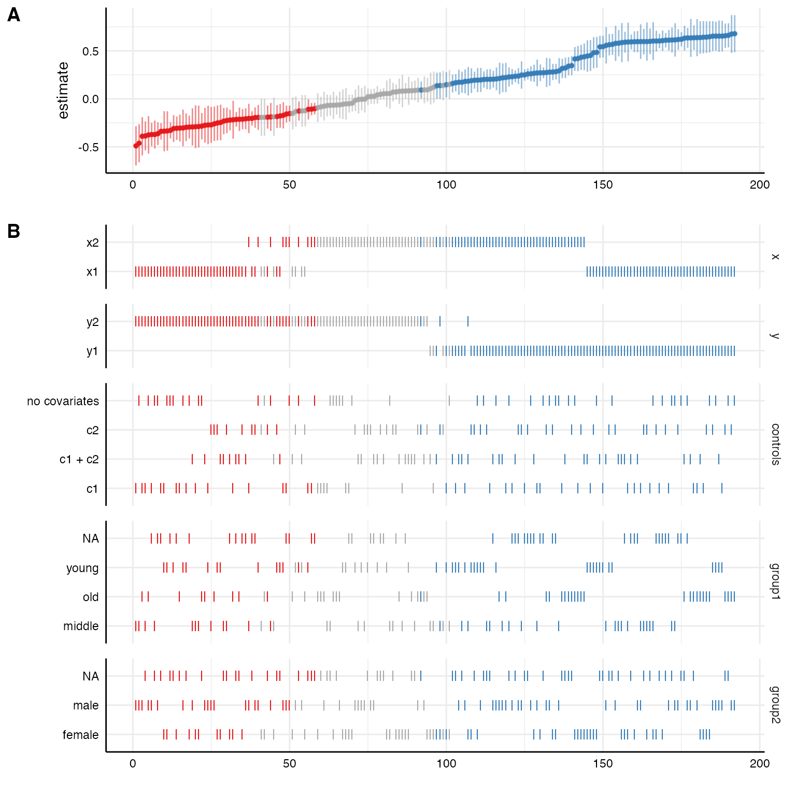
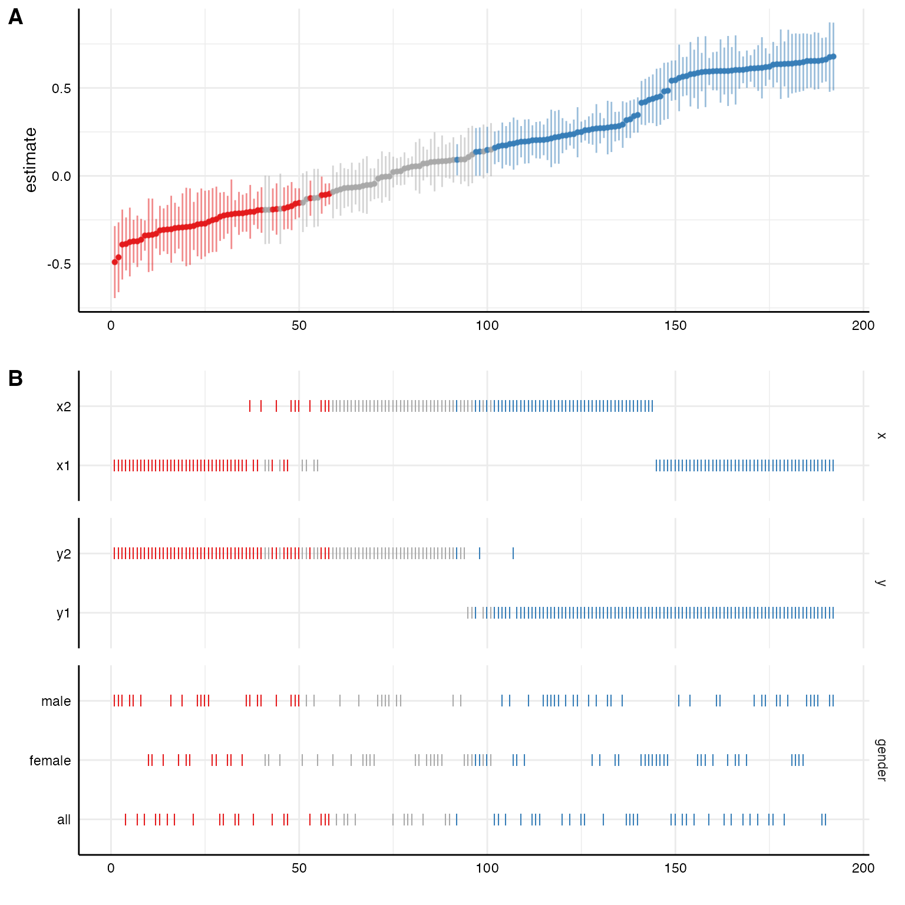
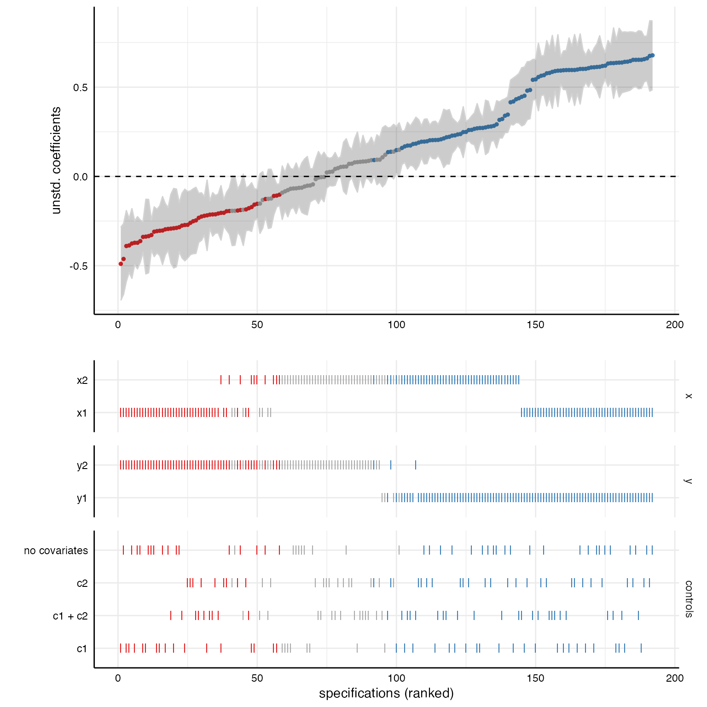
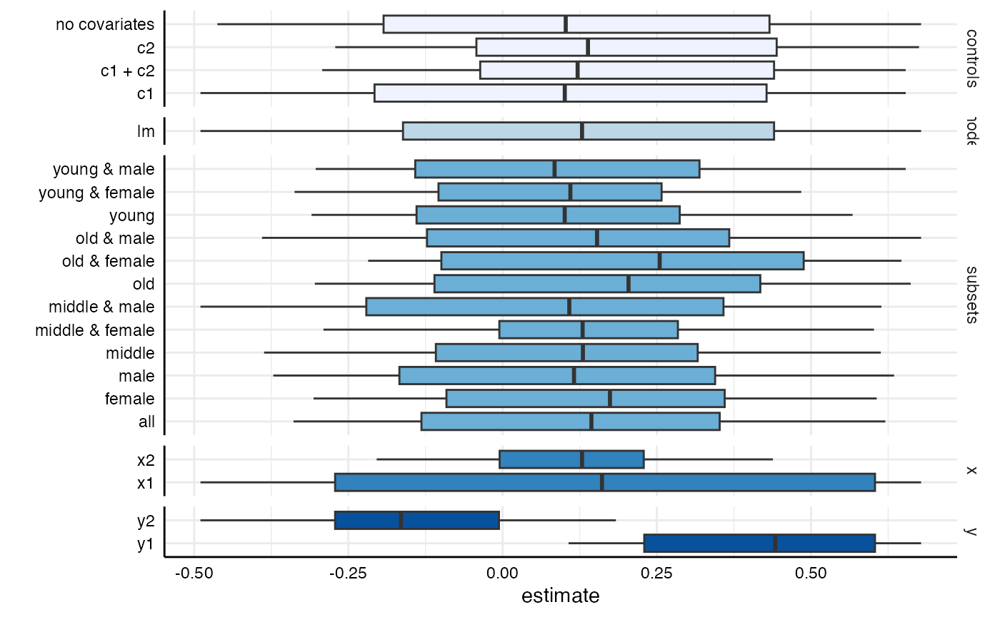
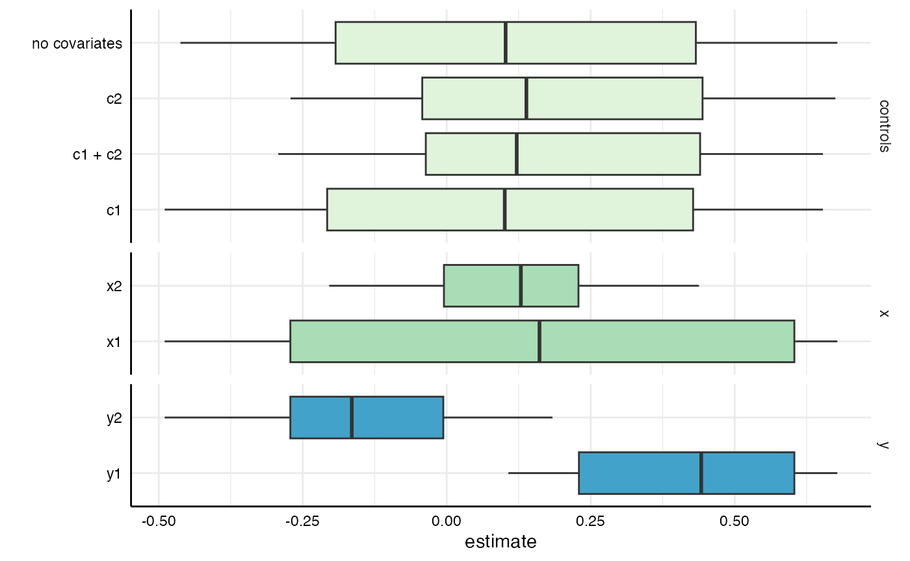
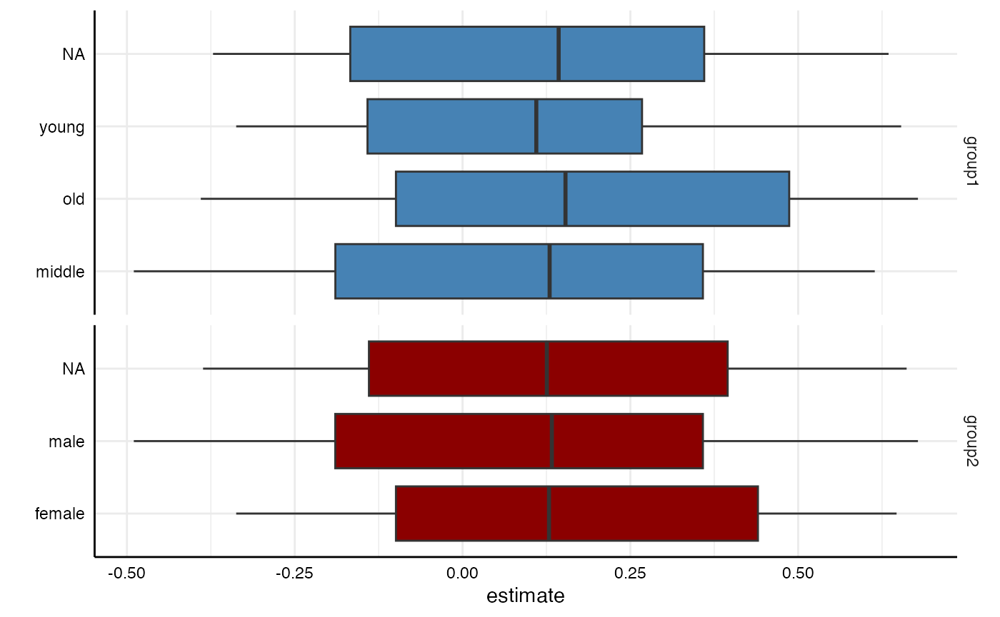
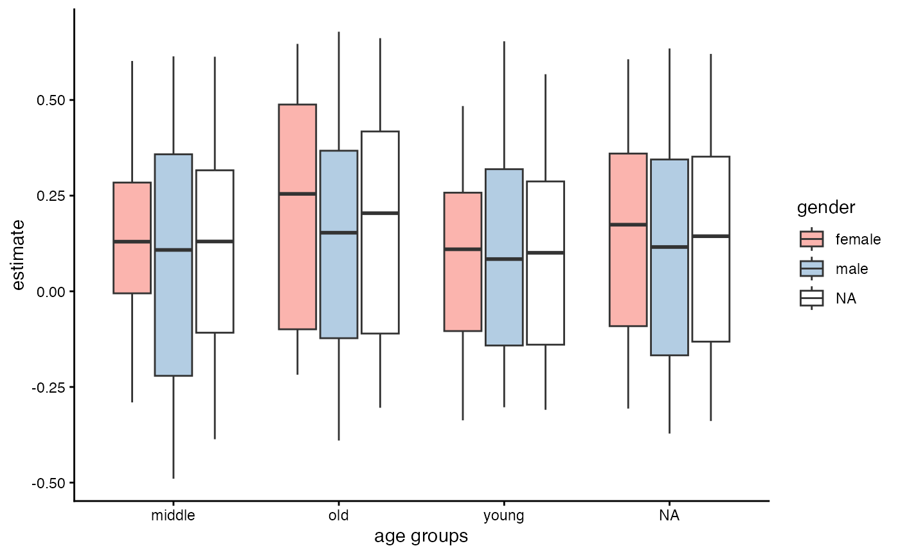

# Visualizing specification curve analyses

This vignette exemplifies different ways to plot results from
specification curve analyses. Since version 1.0.0, running the function
[`specr()`](https://masurp.github.io/specr/reference/specr.md) creates
an object of class `specr.object`, which can be investigated and plotted
using generic functions (e.g.,
[`summary()`](https://rdrr.io/r/base/summary.html) and
[`plot()`](https://rdrr.io/r/graphics/plot.default.html)). For most
cases, simply wrapping the function
[`plot()`](https://rdrr.io/r/graphics/plot.default.html) around the
results will already create a comprehensive visualization. However, more
specific customization is possible if we specify the argument `type`
(e.g., `type = "curve"`). Different types are available. All of
resulting plots are objects of the class
[ggplot](https://ggplot2.tidyverse.org/index.html), which means they can
be customized and adjusted further using the grammar of graphics
provided by the package
[ggplot2](https://ggplot2.tidyverse.org/index.html). specr also exports
the function
[`plot_grid()`](https://wilkelab.org/cowplot/reference/plot_grid.html)
from the package `cowplot`, which can be used to combine different types
of plots.

## Specification curve analysis

### Setting up specifications

In order to have some data to work with, we will use the example data
included in the package.

\
`# Load packages`\
[`library`](https://rdrr.io/r/base/library.html)`(`[`tidyverse`](https://tidyverse.tidyverse.org)`)`\
[`library`](https://rdrr.io/r/base/library.html)`(`[`specr`](https://masurp.github.io/specr/)`)`\
\
`# Setup specifications`\
`specs`` ``<-`` `[`setup`](https://masurp.github.io/specr/reference/setup.md)`(``data ``=`` ``example_data``,`\
`               y ``=`` `[`c`](https://rdrr.io/r/base/c.html)`(``"y1"``, ``"y2"``)``,`\
`               x ``=`` `[`c`](https://rdrr.io/r/base/c.html)`(``"x1"``, ``"x2"``)``,`\
`               model ``=`` ``"lm"``,`\
`               controls ``=`` `[`c`](https://rdrr.io/r/base/c.html)`(``"c1"``, ``"c2"``)``,`\
`               subsets ``=`` `[`list`](https://rdrr.io/r/base/list.html)`(``group1 ``=`` `[`c`](https://rdrr.io/r/base/c.html)`(``"young"``, ``"middle"``, ``"old"``)``,`\
`                              group2 ``=`` `[`c`](https://rdrr.io/r/base/c.html)`(``"female"``, ``"male"``)``)``)`\
\
`# Summary of the specification setup`\
[`summary`](https://rdrr.io/r/base/summary.html)`(``specs``)`

    ## Setup for the Specification Curve Analysis
    ## -------------------------------------------
    ## Class:                      specr.setup -- version: 1.1.0 
    ## Number of specifications:   192 
    ## 
    ## Specifications:
    ## 
    ##   Independent variable:     x1, x2 
    ##   Dependent variable:       y1, y2 
    ##   Models:                   lm 
    ##   Covariates:               no covariates, c1, c2, c1 + c2 
    ##   Subsets analyses:         young & female, middle & female, old & female, female, young & male, middle & male, old & male, male, young, middle, old, all 
    ## 
    ## Function used to extract parameters:
    ## 
    ##   function (x) 
    ## broom::tidy(x, conf.int = TRUE)
    ## <environment: namespace:specr>
    ## 
    ## 
    ## Head of specifications table (first 6 rows):
    ## 
    ## # A tibble: 6 × 8
    ##   x     y     model controls      subsets         group1 group2 formula    
    ##   <chr> <chr> <chr> <chr>         <chr>           <fct>  <fct>  <glue>     
    ## 1 x1    y1    lm    no covariates young & female  young  female y1 ~ x1 + 1
    ## 2 x1    y1    lm    no covariates middle & female middle female y1 ~ x1 + 1
    ## 3 x1    y1    lm    no covariates old & female    old    female y1 ~ x1 + 1
    ## 4 x1    y1    lm    no covariates female          NA     female y1 ~ x1 + 1
    ## 5 x1    y1    lm    no covariates young & male    young  male   y1 ~ x1 + 1
    ## 6 x1    y1    lm    no covariates middle & male   middle male   y1 ~ x1 + 1

We can see that we will estimate 192 models.

### Fitting the models

Next, we fit the models across these 192 specifications. As this example
won’t take much time, we do not parallelize (see
[`vignette("parallelization")`](https://masurp.github.io/specr/articles/parallelization.md)
for how to do so).

\
`# Running specification curve analysis `\
`results`` ``<-`` `[`specr`](https://masurp.github.io/specr/reference/specr.md)`(``specs``)`

### Investigating the results

Let’s quickly get some ideas about the specification curve by using the
generic [`summary()`](https://rdrr.io/r/base/summary.html) function.

\
`# Overall summary`\
[`summary`](https://rdrr.io/r/base/summary.html)`(``results``)`

    ## Results of the specification curve analysis
    ## -------------------
    ## Technical details:
    ## 
    ##   Class:                          specr.object -- version: 1.1.0 
    ##   Cores used:                     1 
    ##   Duration of fitting process:    0.361 sec elapsed 
    ##   Number of specifications:       192 
    ## 
    ## Descriptive summary of the specification curve:
    ## 
    ##  median  mad   min  max   q25  q75
    ##    0.13 0.45 -0.49 0.68 -0.16 0.44
    ## 
    ## Descriptive summary of sample sizes: 
    ## 
    ##  median min  max
    ##     250 160 1000
    ## 
    ## Head of the specification results (first 6 rows): 
    ## 
    ## # A tibble: 6 × 26
    ##   x     y     model controls    subsets group1 group2 formula estimate std.error
    ##   <chr> <chr> <chr> <chr>       <chr>   <fct>  <fct>  <glue>     <dbl>     <dbl>
    ## 1 x1    y1    lm    no covaria… young … young  female y1 ~ x…     0.48      0.08
    ## 2 x1    y1    lm    no covaria… middle… middle female y1 ~ x…     0.6       0.1 
    ## 3 x1    y1    lm    no covaria… old & … old    female y1 ~ x…     0.65      0.08
    ## 4 x1    y1    lm    no covaria… female  NA     female y1 ~ x…     0.61      0.05
    ## 5 x1    y1    lm    no covaria… young … young  male   y1 ~ x…     0.65      0.08
    ## 6 x1    y1    lm    no covaria… middle… middle male   y1 ~ x…     0.61      0.09
    ## # ℹ 16 more variables: statistic <dbl>, p.value <dbl>, conf.low <dbl>,
    ## #   conf.high <dbl>, fit_r.squared <dbl>, fit_adj.r.squared <dbl>,
    ## #   fit_sigma <dbl>, fit_statistic <dbl>, fit_p.value <dbl>, fit_df <dbl>,
    ## #   fit_logLik <dbl>, fit_AIC <dbl>, fit_BIC <dbl>, fit_deviance <dbl>,
    ## #   fit_df.residual <dbl>, fit_nobs <dbl>

The median effect size is b = 0.13 (mad = 0.45). Sample sizes range from
160 to 1000 (the full data set). We can also summarize different aspects
in more detail. For example, by adding `type = "curve"`, we are able to
produce descriptive summaries of the multiverse of parameters.

\
`# Specific descriptive analysis of the curve, grouped by x and y`\
[`summary`](https://rdrr.io/r/base/summary.html)`(``results``, `\
`        type ``=`` ``"curve"``, `\
`        group ``=`` `[`c`](https://rdrr.io/r/base/c.html)`(``"x"``, ``"y"``)``)`

    ## # A tibble: 4 × 9
    ##   x     y       median    mad    min    max     q25     q75   obs
    ##   <chr> <chr>    <dbl>  <dbl>  <dbl>  <dbl>   <dbl>   <dbl> <dbl>
    ## 1 x1    y1     0.605   0.0446  0.446  0.678  0.589   0.638    250
    ## 2 x1    y2    -0.272   0.0905 -0.490 -0.124 -0.314  -0.207    250
    ## 3 x2    y1     0.229   0.0651  0.107  0.438  0.193   0.276    250
    ## 4 x2    y2    -0.00536 0.115  -0.204  0.184 -0.0784  0.0731   250

We see that it makes quite a difference what variables are actually used
to estimate the relationship.

## Visualizations

The primary goal of this vignette is to provide some examples of how
these results - and specifically the specification curve - can be
visualized. Because we received an object of class `specr.object`, we
can create most visualizations using the generic
[`plot()`](https://rdrr.io/r/graphics/plot.default.html) function.
Different plots can be created by changing the argument `type` (e.g.,
`type = "boxplot"`).

### Comprehensive standard visualization

The simplest way to visualize most of the information contained in the
results data frame is by using the
[`plot()`](https://rdrr.io/r/graphics/plot.default.html) function
without any further arguments specified. In the background, the function
is actually set to `type = "default"`, which creates both the
specification curve plot and the choice panel and combines them into a
larger figure.

\
[`plot`](https://rdrr.io/r/graphics/plot.default.html)`(``results``)`

We can further customize that function, e.g., by removing unnecessary
information (in this case we only specified one model, plotting this
analytical choice is hence useless) or by reordering/transforming the
analytical choices (and thereby visualize specific contrasts).

\
`# Customizing plot`\
[`plot`](https://rdrr.io/r/graphics/plot.default.html)`(``results``, `\
`     choices ``=`` `[`c`](https://rdrr.io/r/base/c.html)`(``"x"``, ``"y"``, ``"controls"``, ``# model is not plotted`\
`                 ``"group1"``, ``"group2"``)``,  ``# subset split into original groups`\
`     rel_heights ``=`` `[`c`](https://rdrr.io/r/base/c.html)`(``.75``, ``2``)``)``          ``# changing relative heights`

\
`# Investigating specific contrasts`\
`results``$``data`` ``<-`` ``results``$``data`` `[`%>%`](https://magrittr.tidyverse.org/reference/pipe.html)\
`  `[`mutate`](https://dplyr.tidyverse.org/reference/mutate.html)`(``gender ``=`` `[`ifelse`](https://rdrr.io/r/base/ifelse.html)`(`[`grepl`](https://rdrr.io/r/base/grep.html)`(``"female"``, ``subsets``)``, ``"female"``, `\
`                         `[`ifelse`](https://rdrr.io/r/base/ifelse.html)`(`[`grepl`](https://rdrr.io/r/base/grep.html)`(``"male"``, ``subsets``)``, ``"male"``, ``"all"``)``)``)`\
\
`# New variable as "choice"`\
[`plot`](https://rdrr.io/r/graphics/plot.default.html)`(``results``, `\
`     choices ``=`` `[`c`](https://rdrr.io/r/base/c.html)`(``"x"``, ``"y"``, ``"gender"``)``)`

### More advanced customization

#### Plot curve and choices separately

Using `plot(x, type = "default")` is not very flexible. It is designed
to provide a quick, but meaningful visualization that covers the most
important aspects of the analysis. Alternatively, we can plot the
specification curve and the choice panel individually and bind them
together afterwards. This is useful as it allows us to customize and
change both individual plots (using ggplot-functions!)

\
`# Plot specification curve`\
`p1`` ``<-`` `[`plot`](https://rdrr.io/r/graphics/plot.default.html)`(``results``, `\
`           type ``=`` ``"curve"``,`\
`           ci ``=`` ``FALSE``, `\
`           ribbon ``=`` ``TRUE``)`` ``+`\
`  `[`geom_hline`](https://ggplot2.tidyverse.org/reference/geom_abline.html)`(``yintercept ``=`` ``0``, `\
`             linetype ``=`` ``"dashed"``, `\
`             color ``=`` ``"black"``)`` ``+`\
`  `[`labs`](https://ggplot2.tidyverse.org/reference/labs.html)`(``x ``=`` ``""``, y ``=`` ``"unstd. coefficients"``)`\
\
`# Plot choices`\
`p2`` ``<-`` `[`plot`](https://rdrr.io/r/graphics/plot.default.html)`(``results``, `\
`           type ``=`` ``"choices"``,`\
`           choices ``=`` `[`c`](https://rdrr.io/r/base/c.html)`(``"x"``, ``"y"``, ``"controls"``)``)`` ``+`\
`  `[`labs`](https://ggplot2.tidyverse.org/reference/labs.html)`(``x ``=`` ``"specifications (ranked)"``)`\
\
`# Combine plots (see ?plot_grid for possible adjustments)`\
[`plot_grid`](https://wilkelab.org/cowplot/reference/plot_grid.html)`(``p1``, ``p2``,`\
`          ncol ``=`` ``1``,           `\
`          align ``=`` ``"v"``,             ``# to align vertically`\
`          axis ``=`` ``"rbl"``,            ``# align axes`\
`          rel_heights ``=`` `[`c`](https://rdrr.io/r/base/c.html)`(``2``, ``2``)``)``   ``# adjust relative heights`

#### Include sample size histogram

By default, we do not know how many participants were included in each
specification. If you removed missing values listwise beforehand, this
may not be a big problem as all models are based on the same subsample.
If you have missing values in your dataset and you did not impute them
or delete them listwise, we should investigate how many participants
were included in each specification. Using
`plot(x, type = "samplesizes")`, we get a barplot that shows the sample
size per specification.

\
`p3`` ``<-`` `[`plot`](https://rdrr.io/r/graphics/plot.default.html)`(``results``, type ``=`` ``"samplesizes"``)`` `\
\
`# Add to overall plot`\
[`plot_grid`](https://wilkelab.org/cowplot/reference/plot_grid.html)`(``p1``, ``p2``, ``p3``,`\
`          ncol ``=`` ``1``,`\
`          align ``=`` ``"v"``,`\
`          axis ``=`` ``"rbl"``,`\
`          rel_heights ``=`` `[`c`](https://rdrr.io/r/base/c.html)`(``1.5``, ``2``, ``0.8``)``)`

### Alternative way to visualize specification results

Although the above created figure is by far the most used in studies
using specification curve analysis, there are alternative ways to
visualize the results. As the parameters resulting from the different
specifications are in fact a distribution of parameters, a box-n-whisker
plot (short “boxplot”) is a great alternative to investigate differences
in results contingent on analytical choices. We simply have to use the
argument `type = "boxplot"` to create such plots.

\
`# All choices`\
[`plot`](https://rdrr.io/r/graphics/plot.default.html)`(``results``, `\
`     type ``=`` ``"boxplot"``)`` `

\
`# Specific choices and further adjustments`\
[`plot`](https://rdrr.io/r/graphics/plot.default.html)`(``results``, `\
`     type ``=`` ``"boxplot"``, `\
`     choices ``=`` `[`c`](https://rdrr.io/r/base/c.html)`(``"x"``, ``"y"``, ``"controls"``)``)`` ``+`\
`  `[`scale_fill_brewer`](https://ggplot2.tidyverse.org/reference/scale_brewer.html)`(``palette ``=`` ``4``)`

\
[`plot`](https://rdrr.io/r/graphics/plot.default.html)`(``results``, `\
`     type ``=`` ``"boxplot"``,`\
`     choices ``=`` `[`c`](https://rdrr.io/r/base/c.html)`(``"group1"``, ``"group2"``)``)`` ``+`\
`  `[`scale_fill_manual`](https://ggplot2.tidyverse.org/reference/scale_manual.html)`(``values ``=`` `[`c`](https://rdrr.io/r/base/c.html)`(``"steelblue"``, ``"darkred"``)``)`

Bear in mind, however, that next to these generic functions, we can
always use the resulting data frame and plot our own figures.

\
`results`` `[`%>%`](https://magrittr.tidyverse.org/reference/pipe.html)\
`  ``as_tibble`` `[`%>%`](https://magrittr.tidyverse.org/reference/pipe.html)\
`  `[`ggplot`](https://ggplot2.tidyverse.org/reference/ggplot.html)`(`[`aes`](https://ggplot2.tidyverse.org/reference/aes.html)`(``x ``=`` ``group1``, y ``=`` ``estimate``, fill ``=`` ``group2``)``)`` ``+`\
`  `[`geom_boxplot`](https://ggplot2.tidyverse.org/reference/geom_boxplot.html)`(``)`` ``+`\
`  `[`scale_fill_brewer`](https://ggplot2.tidyverse.org/reference/scale_brewer.html)`(``palette ``=`` ``"Pastel1"``)`` ``+`\
`  `[`theme_classic`](https://ggplot2.tidyverse.org/reference/ggtheme.html)`(``)`` ``+`\
`  `[`labs`](https://ggplot2.tidyverse.org/reference/labs.html)`(``x ``=`` ``"age groups"``, fill ``=`` ``"gender"``)`

