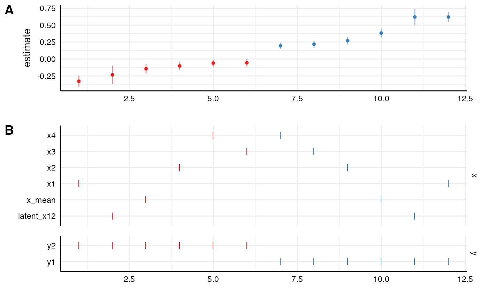
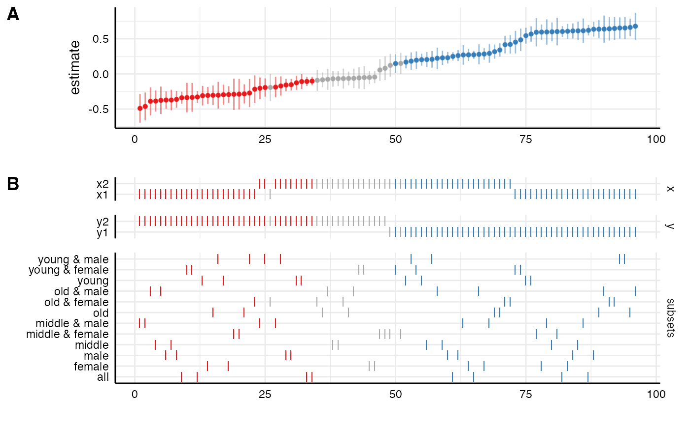
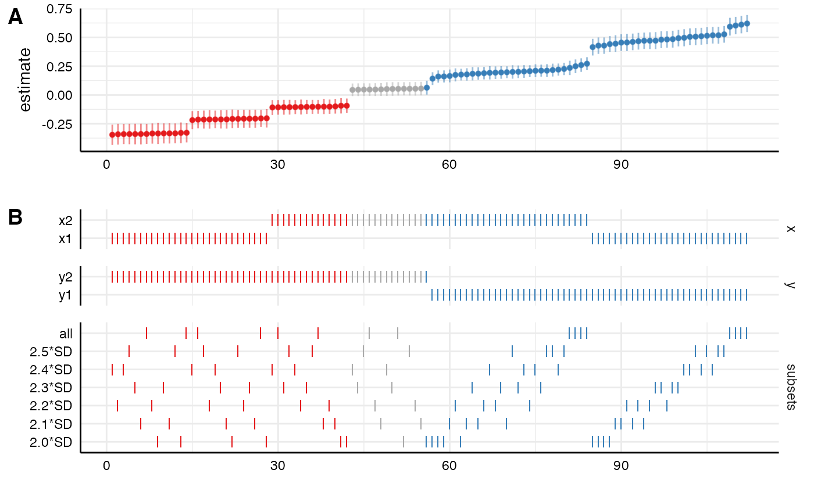
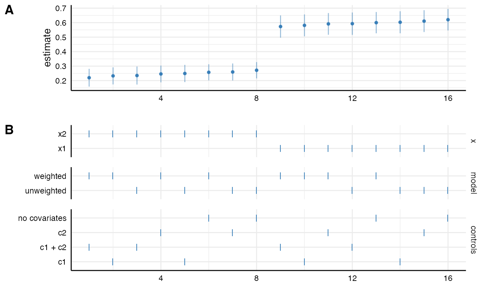
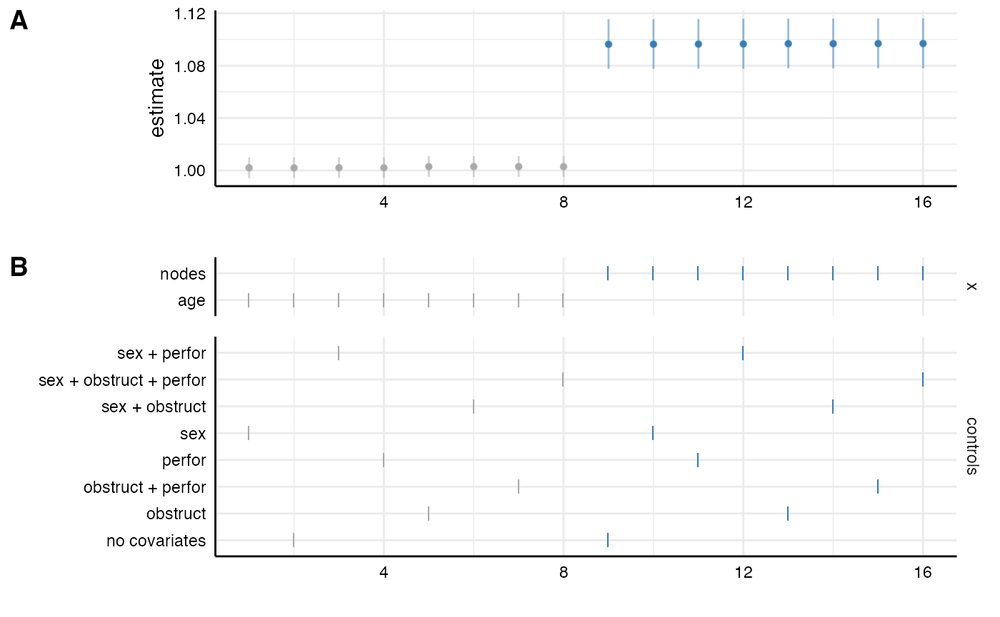
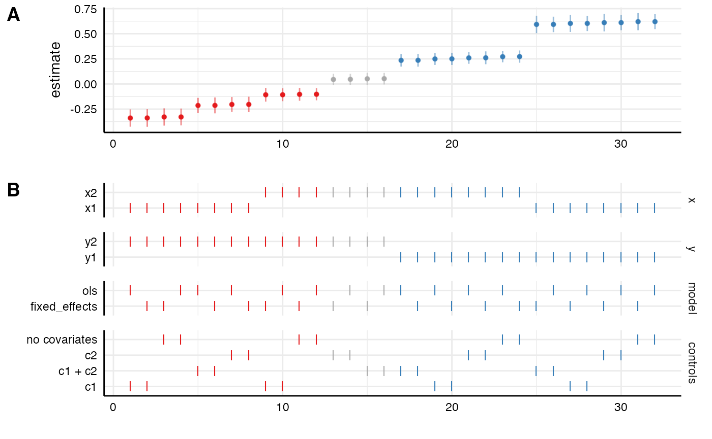

# Setting up different types of specifications

The function
[`setup()`](https://masurp.github.io/specr/reference/setup.md) seems
rather simple, but it is in fact very versatile and allows to
incorporate (almost) any analytic choice that one might engage in during
data analysis. In this vignette, I am going to exemplify how this
function can be used to create several analytical choices.

\
[`library`](https://rdrr.io/r/base/library.html)`(`[`tidyverse`](https://tidyverse.tidyverse.org)`)`\
[`library`](https://rdrr.io/r/base/library.html)`(`[`specr`](https://masurp.github.io/specr/)`)`

## Different independent and dependent variables

One analytic choice may refer to choosing different independent or
dependent variables (e.g., different scales that measure the same
construct) or different ways in how these variables are compute (e.g.,
mean vs. latent measurement, log-transformation, etc).

### Simply providing different variable as vectors

In most cases, this simply means adding such variables to the data set
and provide them as alternative choices in setup.

\
`# Setup specs`\
`specs`` ``<-`` `[`setup`](https://masurp.github.io/specr/reference/setup.md)`(``data ``=`` ``example_data``,`\
`               x ``=`` `[`c`](https://rdrr.io/r/base/c.html)`(``"x1"``, ``"x2"``, ``"x3"``, ``"x4"``)``,`\
`               y ``=`` `[`c`](https://rdrr.io/r/base/c.html)`(``"y1"``, ``"y2"``, ``"y3"``)``,`\
`               model ``=`` ``"lm"``)`\
\
`# Summary of specifications`\
[`summary`](https://rdrr.io/r/base/summary.html)`(``specs``, rows ``=`` ``12``)`

    ## Setup for the Specification Curve Analysis
    ## -------------------------------------------
    ## Class:                      specr.setup -- version: 1.1.0 
    ## Number of specifications:   12 
    ## 
    ## Specifications:
    ## 
    ##   Independent variable:     x1, x2, x3, x4 
    ##   Dependent variable:       y1, y2, y3 
    ##   Models:                   lm 
    ##   Covariates:               no covariates 
    ##   Subsets analyses:         all 
    ## 
    ## Function used to extract parameters:
    ## 
    ##   function (x) 
    ## broom::tidy(x, conf.int = TRUE)
    ## <environment: namespace:specr>
    ## 
    ## 
    ## Head of specifications table (first 12 rows):
    ## 
    ## # A tibble: 12 × 6
    ##    x     y     model controls      subsets formula    
    ##    <chr> <chr> <chr> <chr>         <chr>   <glue>     
    ##  1 x1    y1    lm    no covariates all     y1 ~ x1 + 1
    ##  2 x1    y2    lm    no covariates all     y2 ~ x1 + 1
    ##  3 x1    y3    lm    no covariates all     y3 ~ x1 + 1
    ##  4 x2    y1    lm    no covariates all     y1 ~ x2 + 1
    ##  5 x2    y2    lm    no covariates all     y2 ~ x2 + 1
    ##  6 x2    y3    lm    no covariates all     y3 ~ x2 + 1
    ##  7 x3    y1    lm    no covariates all     y1 ~ x3 + 1
    ##  8 x3    y2    lm    no covariates all     y2 ~ x3 + 1
    ##  9 x3    y3    lm    no covariates all     y3 ~ x3 + 1
    ## 10 x4    y1    lm    no covariates all     y1 ~ x4 + 1
    ## 11 x4    y2    lm    no covariates all     y2 ~ x4 + 1
    ## 12 x4    y3    lm    no covariates all     y3 ~ x4 + 1

\
`# Run analysis and plot results`\
`results`` ``<-`` `[`specr`](https://masurp.github.io/specr/reference/specr.md)`(``specs``)`\
[`head`](https://rdrr.io/r/utils/head.html)`(``results``$``data``)`

    ## # A tibble: 6 × 26
    ##   x     y     model controls      subsets formula  model_function term  estimate
    ##   <chr> <chr> <chr> <chr>         <chr>   <glue>   <list>         <chr>    <dbl>
    ## 1 x1    y1    lm    no covariates all     y1 ~ x1… <fn>           x1      0.620 
    ## 2 x1    y2    lm    no covariates all     y2 ~ x1… <fn>           x1     -0.328 
    ## 3 x1    y3    lm    no covariates all     y3 ~ x1… <fn>           x1     -0.0821
    ## 4 x2    y1    lm    no covariates all     y1 ~ x2… <fn>           x2      0.272 
    ## 5 x2    y2    lm    no covariates all     y2 ~ x2… <fn>           x2     -0.102 
    ## 6 x2    y3    lm    no covariates all     y3 ~ x2… <fn>           x2     -0.0735
    ## # ℹ 17 more variables: std.error <dbl>, statistic <dbl>, p.value <dbl>,
    ## #   conf.low <dbl>, conf.high <dbl>, fit_r.squared <dbl>,
    ## #   fit_adj.r.squared <dbl>, fit_sigma <dbl>, fit_statistic <dbl>,
    ## #   fit_p.value <dbl>, fit_df <dbl>, fit_logLik <dbl>, fit_AIC <dbl>,
    ## #   fit_BIC <dbl>, fit_deviance <dbl>, fit_df.residual <int>, fit_nobs <int>

### Specific variable/model combinations

However, in some cases, we may have different type of variables (e.g., a
mean vs. a dichotomous variable). In some cases, for example when this
refers to a dependent variable, such a choice of variables requires also
different model estimation functions. So in our setup, we want to
acknowledge for specific variable/model combinations. In the following,
let’s imagine that next to our standard dependent variables (`y1`-`y3`),
we also have a dichotomous item (`y_dich`; here only recoded from `y1`).
In this case, we want to specify and add a custom function - here a
logistic model (`glm(formula, data, family = binomial())`) - to the
setup.

\
`# Dichotomous dependent variable`\
`data`` ``<-`` ``example_data`` `[`%>%`](https://magrittr.tidyverse.org/reference/pipe.html)\
`  `[`mutate`](https://dplyr.tidyverse.org/reference/mutate.html)`(``y_dich ``=`` `[`ifelse`](https://rdrr.io/r/base/ifelse.html)`(``y1`` ``>`` `[`mean`](https://rdrr.io/r/base/mean.html)`(``y1``)``, ``1``, ``0``)``)`\
\
`# Specific function`\
`log_glm`` ``<-`` ``function``(``formula``, ``data``)`` ``{`\
`  `[`glm`](https://rdrr.io/r/stats/glm.html)`(``formula``, ``data``, family ``=`` `[`binomial`](https://rdrr.io/r/stats/family.html)`(``)``)`\
`}`\
\
`# Setup specs`\
`specs`` ``<-`` `[`setup`](https://masurp.github.io/specr/reference/setup.md)`(``data ``=`` ``data``,`\
`               x ``=`` `[`c`](https://rdrr.io/r/base/c.html)`(``"x1"``, ``"x2"``)``,`\
`               y ``=`` `[`c`](https://rdrr.io/r/base/c.html)`(``"y1"``, ``"y2"``, ``"y3"``, ``"y_dich"``)``,`\
`               model ``=`` `[`c`](https://rdrr.io/r/base/c.html)`(``"lm"``, ``"log_glm"``)``)`\
`# Check`\
`specs`` `[`%>%`](https://magrittr.tidyverse.org/reference/pipe.html)\
`  ``as_tibble`

    ## # A tibble: 16 × 7
    ##    x     y      model   controls      subsets formula         model_function
    ##    <chr> <chr>  <chr>   <chr>         <chr>   <glue>          <list>        
    ##  1 x1    y1     lm      no covariates all     y1 ~ x1 + 1     <fn>          
    ##  2 x1    y1     log_glm no covariates all     y1 ~ x1 + 1     <fn>          
    ##  3 x1    y2     lm      no covariates all     y2 ~ x1 + 1     <fn>          
    ##  4 x1    y2     log_glm no covariates all     y2 ~ x1 + 1     <fn>          
    ##  5 x1    y3     lm      no covariates all     y3 ~ x1 + 1     <fn>          
    ##  6 x1    y3     log_glm no covariates all     y3 ~ x1 + 1     <fn>          
    ##  7 x1    y_dich lm      no covariates all     y_dich ~ x1 + 1 <fn>          
    ##  8 x1    y_dich log_glm no covariates all     y_dich ~ x1 + 1 <fn>          
    ##  9 x2    y1     lm      no covariates all     y1 ~ x2 + 1     <fn>          
    ## 10 x2    y1     log_glm no covariates all     y1 ~ x2 + 1     <fn>          
    ## 11 x2    y2     lm      no covariates all     y2 ~ x2 + 1     <fn>          
    ## 12 x2    y2     log_glm no covariates all     y2 ~ x2 + 1     <fn>          
    ## 13 x2    y3     lm      no covariates all     y3 ~ x2 + 1     <fn>          
    ## 14 x2    y3     log_glm no covariates all     y3 ~ x2 + 1     <fn>          
    ## 15 x2    y_dich lm      no covariates all     y_dich ~ x2 + 1 <fn>          
    ## 16 x2    y_dich log_glm no covariates all     y_dich ~ x2 + 1 <fn>

As we can see, the
[`setup()`](https://masurp.github.io/specr/reference/setup.md) function
produces all combinations between the variables and the model functions.
This is not meaningful as the logistic model should only be used if the
dependent variable is `y_dich`. In comparison to specr version 0.2.1,
this is where the strength of version 1.0.0 comes in. Because we setup
all specifications beforehand, we can simply remove those that we are
not interested in or that we deem non-meaningful. Note: You won’t be
able to filter or subset the `specr.setup` object (essentially a list).
Instead, you want to filter/subset the first position of the list: the
data frame that includes the specifications (here `specs$specs` or
`specs[[1]]`).

\
`# Filter out models that are not meaningful (here only keep log_glm, when y == "y_dich")`\
`specs``$``specs`` ``<-`` ``specs``$``specs`` `[`%>%`](https://magrittr.tidyverse.org/reference/pipe.html)\
`  `[`filter`](https://dplyr.tidyverse.org/reference/filter.html)`(``!``(``model`` ``==`` ``"log_glm"`` ``&`` ``y`` ``!=`` ``"y_dich"``)``)`` `[`%>%`](https://magrittr.tidyverse.org/reference/pipe.html)\
`  `[`filter`](https://dplyr.tidyverse.org/reference/filter.html)`(``!``(``model`` ``==`` ``"lm"`` ``&`` ``y`` ``==`` ``"y_dich"``)``)`\
\
`# Check results (only meaningful specifications remain)`\
[`summary`](https://rdrr.io/r/base/summary.html)`(``specs``, rows ``=`` ``8``)`

    ## Setup for the Specification Curve Analysis
    ## -------------------------------------------
    ## Class:                      specr.setup -- version: 1.1.0 
    ## Number of specifications:   8 
    ## 
    ## Specifications:
    ## 
    ##   Independent variable:     x1, x2 
    ##   Dependent variable:       y1, y2, y3, y_dich 
    ##   Models:                   lm, log_glm 
    ##   Covariates:               no covariates 
    ##   Subsets analyses:         all 
    ## 
    ## Function used to extract parameters:
    ## 
    ##   function (x) 
    ## broom::tidy(x, conf.int = TRUE)
    ## <environment: namespace:specr>
    ## 
    ## 
    ## Head of specifications table (first 8 rows):
    ## 
    ## # A tibble: 8 × 6
    ##   x     y      model   controls      subsets formula        
    ##   <chr> <chr>  <chr>   <chr>         <chr>   <glue>         
    ## 1 x1    y1     lm      no covariates all     y1 ~ x1 + 1    
    ## 2 x1    y2     lm      no covariates all     y2 ~ x1 + 1    
    ## 3 x1    y3     lm      no covariates all     y3 ~ x1 + 1    
    ## 4 x1    y_dich log_glm no covariates all     y_dich ~ x1 + 1
    ## 5 x2    y1     lm      no covariates all     y1 ~ x2 + 1    
    ## 6 x2    y2     lm      no covariates all     y2 ~ x2 + 1    
    ## 7 x2    y3     lm      no covariates all     y3 ~ x2 + 1    
    ## 8 x2    y_dich log_glm no covariates all     y_dich ~ x2 + 1

\
`# Run analysis and plot results`\
`results`` ``<-`` `[`specr`](https://masurp.github.io/specr/reference/specr.md)`(``specs``)`\
[`head`](https://rdrr.io/r/utils/head.html)`(``results``$``data``)`

    ## # A tibble: 6 × 28
    ##   x     y      model   controls    subsets formula model_function term  estimate
    ##   <chr> <chr>  <chr>   <chr>       <chr>   <glue>  <list>         <chr>    <dbl>
    ## 1 x1    y1     lm      no covaria… all     y1 ~ x… <fn>           x1      0.620 
    ## 2 x1    y2     lm      no covaria… all     y2 ~ x… <fn>           x1     -0.328 
    ## 3 x1    y3     lm      no covaria… all     y3 ~ x… <fn>           x1     -0.0821
    ## 4 x1    y_dich log_glm no covaria… all     y_dich… <fn>           x1      0.753 
    ## 5 x2    y1     lm      no covaria… all     y1 ~ x… <fn>           x2      0.272 
    ## 6 x2    y2     lm      no covaria… all     y2 ~ x… <fn>           x2     -0.102 
    ## # ℹ 19 more variables: std.error <dbl>, statistic <dbl>, p.value <dbl>,
    ## #   conf.low <dbl>, conf.high <dbl>, fit_r.squared <dbl>,
    ## #   fit_adj.r.squared <dbl>, fit_sigma <dbl>, fit_statistic <dbl>,
    ## #   fit_p.value <dbl>, fit_df <dbl>, fit_logLik <dbl>, fit_AIC <dbl>,
    ## #   fit_BIC <dbl>, fit_deviance <dbl>, fit_df.residual <int>, fit_nobs <int>,
    ## #   fit_null.deviance <dbl>, fit_df.null <int>

### Adding composite and latent variables

In some cases, we may want to add mean indices or even latent
measurement models of our variables of interest to explore how latent
vs. manifest measurement affects our results. This requires a bit more
upfront work as we need to work with [lavaan](https://lavaan.ugent.be/)
for the latent measurement. Furthermore, we need to adjust the extract
functions (`fun1` and `fun2` in
[`setup()`](https://masurp.github.io/specr/reference/setup.md)) so that
the extraction of parameters aligns across different type of models. The
beauty of
[`broom::tidy()`](https://generics.r-lib.org/reference/tidy.html) and
[`broom::glance()`](https://generics.r-lib.org/reference/glance.html)
(which are used by default) is that they adapt to the different model
types that are passed to `setup`. Although the same parameters are
extracted for most models, they sometimes differ for specific models
(e.g., structural equation models resulting from
[`lavaan::sem()`](https://rdrr.io/pkg/lavaan/man/sem.html)). This means
we need to adjust them to extract the same parameters across different
models.

\
`# Add mean (one choice)`\
`data`` ``<-`` ``data`` `[`%>%`](https://magrittr.tidyverse.org/reference/pipe.html)\
`  `[`mutate`](https://dplyr.tidyverse.org/reference/mutate.html)`(``x_mean ``=`` `[`rowMeans`](https://rdrr.io/pkg/Matrix/man/colSums-methods.html)`(`[`across`](https://dplyr.tidyverse.org/reference/across.html)`(`[`c`](https://rdrr.io/r/base/c.html)`(``x1``, ``x2``, ``x3``, ``x4``)``)``)``)`\
\
`# Add custom function with latent measurement models to pass to "models" (another choice)`\
`custom_sem`` ``<-`` ``function``(``formula``, ``data``)`` ``{`\
`  `\
`  ``# Add latent measurement as list`\
`  ``latent`` ``<-`` `[`list`](https://rdrr.io/r/base/list.html)`(``latent_x12 ``=`` ``"latent_x12 =~ x1 + x2"``)`\
`  `\
`  ``# Remove +1 from formula as lavaan doesn't know how to process it `\
`  ``semformula`` ``<-`` `[`str_remove_all`](https://stringr.tidyverse.org/reference/str_remove.html)`(``formula``, ``"\\+ 1"``)`\
`  `\
`  ``# remove non-used latent measurement models from list by checking the formula`\
`  ``valid`` ``<-`` ``purrr``::`[`keep`](https://purrr.tidyverse.org/reference/keep.html)`(`[`names`](https://rdrr.io/r/base/names.html)`(``latent``)``, ``~`` ``stringr``::`[`str_detect`](https://stringr.tidyverse.org/reference/str_detect.html)`(``formula``, ``.x``)``)`\
`  `\
`  ``# Create new formula that includes latent measurement models`\
`  ``formula`` ``<-`` `[`paste`](https://rdrr.io/r/base/paste.html)`(``semformula``, ``"\n"``, `[`paste`](https://rdrr.io/r/base/paste.html)`(``latent``[``valid``]``, collapse ``=`` ``" \n "``)``)`\
`  `\
`  ``` # Pass formula to `sem()` ``\
`  ``lavaan``::`[`sem`](https://rdrr.io/pkg/lavaan/man/sem.html)`(``formula``, ``data``)`\
`}`\
\
`# Create custom tidy function that extracts the same parameters from different models!`\
`tidy_new`` ``<-`` ``function``(``x``)`` ``{`\
`  ``if``(`[`inherits`](https://rdrr.io/r/base/class.html)`(``x``, ``"lavaan"``)``)`` ``{`\
`    ``broom``::`[`tidy`](https://generics.r-lib.org/reference/tidy.html)`(``x``, conf.int ``=`` ``TRUE``)`` `[`%>%`](https://magrittr.tidyverse.org/reference/pipe.html)` `\
`    `[`select`](https://dplyr.tidyverse.org/reference/select.html)`(``term``, ``estimate``, ``conf.low``, ``conf.high``)`` `[`%>%`](https://magrittr.tidyverse.org/reference/pipe.html)`   ``# select parameters you want to keep`\
`    `[`filter`](https://dplyr.tidyverse.org/reference/filter.html)`(`[`grepl`](https://rdrr.io/r/base/grep.html)`(``" ~ "``, ``term``)``)`` `[`%>%`](https://magrittr.tidyverse.org/reference/pipe.html)`                    ``# term needs to be adjusted`\
`    `[`separate`](https://tidyr.tidyverse.org/reference/separate.html)`(``term``, `[`c`](https://rdrr.io/r/base/c.html)`(``"dv"``, ``"term"``)``, sep ``=`` ``" ~ "``)`` `[`%>%`](https://magrittr.tidyverse.org/reference/pipe.html)`  ``# extract independent variable`\
`    `[`select`](https://dplyr.tidyverse.org/reference/select.html)`(``-``dv``)``                                       ``# remove dependent variable`\
`  ``}`` ``else`` ``{`\
`    ``broom``::`[`tidy`](https://generics.r-lib.org/reference/tidy.html)`(``x``, conf.int ``=`` ``TRUE``)`` `[`%>%`](https://magrittr.tidyverse.org/reference/pipe.html)` `\
`    `[`select`](https://dplyr.tidyverse.org/reference/select.html)`(``term``, ``estimate``, ``conf.low``, ``conf.high``)``      ``# same parameters as above`\
`  ``}`\
`}`\
\
`# Setup specs with new custom function`\
`specs`` ``<-`` `[`setup`](https://masurp.github.io/specr/reference/setup.md)`(``data ``=`` ``data``,`\
`               x ``=`` `[`c`](https://rdrr.io/r/base/c.html)`(``"x1"``, ``"x2"``, ``"x3"``, ``"x4"``, ``"x_mean"``, ``"latent_x12"``)``,`\
`               y ``=`` `[`c`](https://rdrr.io/r/base/c.html)`(``"y1"``, ``"y2"``)``,`\
`               model ``=`` `[`c`](https://rdrr.io/r/base/c.html)`(``"lm"``, ``"custom_sem"``)``,`\
`               fun1 ``=`` ``tidy_new``, ``# We pass the new extract function`\
`               fun2 ``=`` ``NULL``)``     ``# switch off "glance" as it produces different fit indices and wouldn't work`\
\
`# Quick check (still includes non-meaningful specifications)`\
[`summary`](https://rdrr.io/r/base/summary.html)`(``specs``, rows ``=`` ``12``)`

    ## Setup for the Specification Curve Analysis
    ## -------------------------------------------
    ## Class:                      specr.setup -- version: 1.1.0 
    ## Number of specifications:   24 
    ## 
    ## Specifications:
    ## 
    ##   Independent variable:     x1, x2, x3, x4, x_mean, latent_x12 
    ##   Dependent variable:       y1, y2 
    ##   Models:                   lm, custom_sem 
    ##   Covariates:               no covariates 
    ##   Subsets analyses:         all 
    ## 
    ## Function used to extract parameters:
    ## 
    ##   function (x) 
    ## {
    ##     if (inherits(x, "lavaan")) {
    ##         broom::tidy(x, conf.int = TRUE) %>% select(term, estimate, 
    ##             conf.low, conf.high) %>% filter(grepl(" ~ ", term)) %>% 
    ##             separate(term, c("dv", "term"), sep = " ~ ") %>% 
    ##             select(-dv)
    ##     }
    ##     else {
    ##         broom::tidy(x, conf.int = TRUE) %>% select(term, estimate, 
    ##             conf.low, conf.high)
    ##     }
    ## }
    ## 
    ## 
    ## Head of specifications table (first 12 rows):
    ## 
    ## # A tibble: 12 × 6
    ##    x     y     model      controls      subsets formula    
    ##    <chr> <chr> <chr>      <chr>         <chr>   <glue>     
    ##  1 x1    y1    lm         no covariates all     y1 ~ x1 + 1
    ##  2 x1    y1    custom_sem no covariates all     y1 ~ x1 + 1
    ##  3 x1    y2    lm         no covariates all     y2 ~ x1 + 1
    ##  4 x1    y2    custom_sem no covariates all     y2 ~ x1 + 1
    ##  5 x2    y1    lm         no covariates all     y1 ~ x2 + 1
    ##  6 x2    y1    custom_sem no covariates all     y1 ~ x2 + 1
    ##  7 x2    y2    lm         no covariates all     y2 ~ x2 + 1
    ##  8 x2    y2    custom_sem no covariates all     y2 ~ x2 + 1
    ##  9 x3    y1    lm         no covariates all     y1 ~ x3 + 1
    ## 10 x3    y1    custom_sem no covariates all     y1 ~ x3 + 1
    ## 11 x3    y2    lm         no covariates all     y2 ~ x3 + 1
    ## 12 x3    y2    custom_sem no covariates all     y2 ~ x3 + 1

\
`# Filter out non-meaningful specifications`\
`specs``$``specs`` ``<-`` ``specs``$``specs`` `[`%>%`](https://magrittr.tidyverse.org/reference/pipe.html)\
`  `[`filter`](https://dplyr.tidyverse.org/reference/filter.html)`(``!``(``model`` ``==`` ``"custom_sem"`` ``&`` ``!`[`grepl`](https://rdrr.io/r/base/grep.html)`(``"latent"``, ``x``)``)``)`` `[`%>%`](https://magrittr.tidyverse.org/reference/pipe.html)\
`  `[`filter`](https://dplyr.tidyverse.org/reference/filter.html)`(``!``(``model`` ``==`` ``"lm"`` ``&`` `[`grepl`](https://rdrr.io/r/base/grep.html)`(``"latent"``, ``x``)``)``)`\
\
`# Check again`\
[`summary`](https://rdrr.io/r/base/summary.html)`(``specs``, rows ``=`` ``12``)`

    ## Setup for the Specification Curve Analysis
    ## -------------------------------------------
    ## Class:                      specr.setup -- version: 1.1.0 
    ## Number of specifications:   12 
    ## 
    ## Specifications:
    ## 
    ##   Independent variable:     x1, x2, x3, x4, x_mean, latent_x12 
    ##   Dependent variable:       y1, y2 
    ##   Models:                   lm, custom_sem 
    ##   Covariates:               no covariates 
    ##   Subsets analyses:         all 
    ## 
    ## Function used to extract parameters:
    ## 
    ##   function (x) 
    ## {
    ##     if (inherits(x, "lavaan")) {
    ##         broom::tidy(x, conf.int = TRUE) %>% select(term, estimate, 
    ##             conf.low, conf.high) %>% filter(grepl(" ~ ", term)) %>% 
    ##             separate(term, c("dv", "term"), sep = " ~ ") %>% 
    ##             select(-dv)
    ##     }
    ##     else {
    ##         broom::tidy(x, conf.int = TRUE) %>% select(term, estimate, 
    ##             conf.low, conf.high)
    ##     }
    ## }
    ## 
    ## 
    ## Head of specifications table (first 12 rows):
    ## 
    ## # A tibble: 12 × 6
    ##    x          y     model      controls      subsets formula            
    ##    <chr>      <chr> <chr>      <chr>         <chr>   <glue>             
    ##  1 x1         y1    lm         no covariates all     y1 ~ x1 + 1        
    ##  2 x1         y2    lm         no covariates all     y2 ~ x1 + 1        
    ##  3 x2         y1    lm         no covariates all     y1 ~ x2 + 1        
    ##  4 x2         y2    lm         no covariates all     y2 ~ x2 + 1        
    ##  5 x3         y1    lm         no covariates all     y1 ~ x3 + 1        
    ##  6 x3         y2    lm         no covariates all     y2 ~ x3 + 1        
    ##  7 x4         y1    lm         no covariates all     y1 ~ x4 + 1        
    ##  8 x4         y2    lm         no covariates all     y2 ~ x4 + 1        
    ##  9 x_mean     y1    lm         no covariates all     y1 ~ x_mean + 1    
    ## 10 x_mean     y2    lm         no covariates all     y2 ~ x_mean + 1    
    ## 11 latent_x12 y1    custom_sem no covariates all     y1 ~ latent_x12 + 1
    ## 12 latent_x12 y2    custom_sem no covariates all     y2 ~ latent_x12 + 1

\
`# Run analysis and plot results`\
`results`` ``<-`` `[`specr`](https://masurp.github.io/specr/reference/specr.md)`(``specs``)`\
[`plot`](https://rdrr.io/r/graphics/plot.default.html)`(``results``, choices ``=`` `[`c`](https://rdrr.io/r/base/c.html)`(``"x"``, ``"y"``)``)`



As we can see, we can now investigate the manifest and latent measures
next to the individual items.

## Control variables

Another analytical choice may refer to the inclusion of covariates.
Here, the [`setup()`](https://masurp.github.io/specr/reference/setup.md)
function is again very versatile and allows to include different
combinations of covariates.

### Adding a bunch of control variables

By providing just a vector of covariates,
[`setup()`](https://masurp.github.io/specr/reference/setup.md) produces
all combinations of these covariates plus a specification without any
covariates. If we add the argument `simplify = TRUE`, not all
combinations between covariates are created. Instead, only no
covariates, each individually, and all together are included.

\
`# Setup specification that include all combinations of covariates`\
`specs1`` ``<-`` `[`setup`](https://masurp.github.io/specr/reference/setup.md)`(``data ``=`` ``example_data``,`\
`               x ``=`` `[`c`](https://rdrr.io/r/base/c.html)`(``"x1"``, ``"x2"``)``,`\
`               y ``=`` `[`c`](https://rdrr.io/r/base/c.html)`(``"y1"``, ``"y2"``)``,`\
`               model ``=`` ``"lm"``,`\
`               controls ``=`` `[`c`](https://rdrr.io/r/base/c.html)`(``"c1"``, ``"c2"``, ``"c3"``, ``"c4"``)``)``  ``# simply providing a vector of control variables`\
\
`# Setup specifications that include only no covariates, each individually, and all together`\
`specs2`` ``<-`` `[`setup`](https://masurp.github.io/specr/reference/setup.md)`(``data ``=`` ``example_data``,`\
`               x ``=`` `[`c`](https://rdrr.io/r/base/c.html)`(``"x1"``, ``"x2"``)``,`\
`               y ``=`` `[`c`](https://rdrr.io/r/base/c.html)`(``"y1"``, ``"y2"``)``,`\
`               model ``=`` ``"lm"``,`\
`               controls ``=`` `[`c`](https://rdrr.io/r/base/c.html)`(``"c1"``, ``"c2"``, ``"c3"``, ``"c4"``)``,`\
`               simplify ``=`` ``TRUE``)``   ``# Difference to specs1!`\
\
`# Check`\
[`distinct`](https://dplyr.tidyverse.org/reference/distinct.html)`(``specs1``$``specs``, ``controls``)`

    ## # A tibble: 16 × 1
    ##    controls         
    ##    <chr>            
    ##  1 no covariates    
    ##  2 c1               
    ##  3 c2               
    ##  4 c3               
    ##  5 c4               
    ##  6 c1 + c2          
    ##  7 c1 + c3          
    ##  8 c1 + c4          
    ##  9 c2 + c3          
    ## 10 c2 + c4          
    ## 11 c3 + c4          
    ## 12 c1 + c2 + c3     
    ## 13 c1 + c2 + c4     
    ## 14 c1 + c3 + c4     
    ## 15 c2 + c3 + c4     
    ## 16 c1 + c2 + c3 + c4

\
[`distinct`](https://dplyr.tidyverse.org/reference/distinct.html)`(``specs2``$``specs``, ``controls``)`

    ## # A tibble: 6 × 1
    ##   controls      
    ##   <chr>         
    ## 1 no covariates 
    ## 2 c1            
    ## 3 c2            
    ## 4 c3            
    ## 5 c4            
    ## 6 all covariates

### Sets of covariates

We can also add groups of covariates. The way setup creates combinations
between such groups remains the same.

\
`# Add groups of covariates`\
`specs3`` ``<-`` `[`setup`](https://masurp.github.io/specr/reference/setup.md)`(``data ``=`` ``example_data``,`\
`               x ``=`` `[`c`](https://rdrr.io/r/base/c.html)`(``"x1"``, ``"x2"``)``,`\
`               y ``=`` `[`c`](https://rdrr.io/r/base/c.html)`(``"y1"``, ``"y2"``)``,`\
`               model ``=`` ``"lm"``,`\
`               controls ``=`` `[`c`](https://rdrr.io/r/base/c.html)`(``"c1 + c2"``, ``"c3 + c4"``)``)`\
`# Check`\
[`distinct`](https://dplyr.tidyverse.org/reference/distinct.html)`(``specs3``$``specs``, ``controls``)`

    ## # A tibble: 4 × 1
    ##   controls         
    ##   <chr>            
    ## 1 no covariates    
    ## 2 c1 + c2          
    ## 3 c3 + c4          
    ## 4 c1 + c2 + c3 + c4

The [`setup()`](https://masurp.github.io/specr/reference/setup.md)
function further has an argument `add_to_formula`, which allows to add
covariates (or any other formula-relevant aspects, e.g., random effect
structures) to all model functions.

\
`# Add some control variables to all models`\
`specs4`` ``<-`` `[`setup`](https://masurp.github.io/specr/reference/setup.md)`(``data ``=`` ``example_data``,`\
`               x ``=`` `[`c`](https://rdrr.io/r/base/c.html)`(``"x1"``, ``"x2"``)``,`\
`               y ``=`` `[`c`](https://rdrr.io/r/base/c.html)`(``"y1"``, ``"y2"``)``,`\
`               model ``=`` ``"lm"``,`\
`               controls ``=`` `[`c`](https://rdrr.io/r/base/c.html)`(``"c1"``, ``"c2"``)``,`\
`               add_to_formula ``=`` ``"c3"``)`\
\
`` # Check (see how `c3` is added to each formula, but is not part of controls) ``\
`specs4``$``specs``[``1``:``6``,``]`

    ## # A tibble: 6 × 7
    ##   x     y     model controls      subsets formula                model_function
    ##   <chr> <chr> <chr> <chr>         <chr>   <glue>                 <list>        
    ## 1 x1    y1    lm    no covariates all     y1 ~ x1 + 1 + c3       <fn>          
    ## 2 x1    y1    lm    c1            all     y1 ~ x1 + c1 + c3      <fn>          
    ## 3 x1    y1    lm    c2            all     y1 ~ x1 + c2 + c3      <fn>          
    ## 4 x1    y1    lm    c1 + c2       all     y1 ~ x1 + c1 + c2 + c3 <fn>          
    ## 5 x1    y2    lm    no covariates all     y2 ~ x1 + 1 + c3       <fn>          
    ## 6 x1    y2    lm    c1            all     y2 ~ x1 + c1 + c3      <fn>

### Dealing with duplicates in specifications

Finally, we may sometimes decide to add one of the independent or
dependent variables as covariates as well. In this case, it would not
make sense to add e.g., `x1` as covariate if it is already the
independent variable. In this new version of specr, the
[`setup()`](https://masurp.github.io/specr/reference/setup.md) function
automatically detects such duplications and deletes such specifications.

\
`# Adding a covariate that is also an independent or dependent variable`\
`specs5`` ``<-`` `[`setup`](https://masurp.github.io/specr/reference/setup.md)`(``data ``=`` ``example_data``,`\
`               x ``=`` `[`c`](https://rdrr.io/r/base/c.html)`(``"x1"``, ``"x2"``)``,`\
`               y ``=`` `[`c`](https://rdrr.io/r/base/c.html)`(``"y1"``, ``"y2"``)``,`\
`               model ``=`` ``"lm"``,`\
`               controls ``=`` `[`c`](https://rdrr.io/r/base/c.html)`(``"x1"``, ``"y1"``)``)`\
\
`# Check (see how only 9 specifications are kept)`\
`specs5``$``specs`

    ## # A tibble: 9 × 7
    ##   x     y     model controls      subsets formula           model_function
    ##   <chr> <chr> <chr> <chr>         <chr>   <glue>            <list>        
    ## 1 x1    y1    lm    no covariates all     y1 ~ x1 + 1       <fn>          
    ## 2 x1    y2    lm    no covariates all     y2 ~ x1 + 1       <fn>          
    ## 3 x1    y2    lm    y1            all     y2 ~ x1 + y1      <fn>          
    ## 4 x2    y1    lm    no covariates all     y1 ~ x2 + 1       <fn>          
    ## 5 x2    y1    lm    x1            all     y1 ~ x2 + x1      <fn>          
    ## 6 x2    y2    lm    no covariates all     y2 ~ x2 + 1       <fn>          
    ## 7 x2    y2    lm    x1            all     y2 ~ x2 + x1      <fn>          
    ## 8 x2    y2    lm    y1            all     y2 ~ x2 + y1      <fn>          
    ## 9 x2    y2    lm    x1 + y1       all     y2 ~ x2 + x1 + y1 <fn>

## Subset analyses

One of the most powerful arguments within the
[`setup()`](https://masurp.github.io/specr/reference/setup.md) framework
is `subsets`, which can be used for so-called “subset analyses”. With
this argument, a variety of analytical choices can be included.

### Simple subset analysis based on grouping variables

In simple cases, we may want to investigate whether a relationship
differs across certain subgroups. In the example data, we can for
example investigate whether the relationship between `x` and `y` differs
across age groups (`group1`) and gender (`group2`). We can add such
subset analyses by specifying a list in two alternative ways. The
easiest way refers to simply providing named vectors that refer to the
respective variables in the data set and their unique values:

    list(group1 = c("young", "middle", "old"),
          group2 = c("female", "male"))

Alternatively, we can achieve the same thing by using the function
[`unique()`](https://rdrr.io/r/base/unique.html), which extracts the
unique values from each variable in the data set:

    list(group1 = unique(example_data$group1),
         group2 = unique(example_data$group2))

These lists are then passed as combinatorial factors to the expand
function within
[`setup()`](https://masurp.github.io/specr/reference/setup.md). If two
or more grouping variables are provided in this way (you can provide as
many as you want, but it quickly becomes messy),
[`setup()`](https://masurp.github.io/specr/reference/setup.md)
automatically adds them as “choice” columns to the specification setup
data frame. Note how it automatically adds the value `NA` to make sure
that also the simple subsets and not only the combinations between the
two groups are included in the specifications. It further creates a new
column “subsets”, which represents the combination of the subsetting
factors.

\
`# Setup specifications`\
`specs`` ``<-`` `[`setup`](https://masurp.github.io/specr/reference/setup.md)`(``data ``=`` ``example_data``,`\
`               x ``=`` `[`c`](https://rdrr.io/r/base/c.html)`(``"x1"``, ``"x2"``)``,`\
`               y ``=`` `[`c`](https://rdrr.io/r/base/c.html)`(``"y1"``, ``"y2"``)``,`\
`               model ``=`` `[`c`](https://rdrr.io/r/base/c.html)`(``"lm"``)``,`\
`               controls ``=`` ``"c1"``,`\
`               subsets ``=`` `[`list`](https://rdrr.io/r/base/list.html)`(``group1 ``=`` `[`unique`](https://rdrr.io/r/base/unique.html)`(``example_data``$``group1``)``,`\
`                              group2 ``=`` `[`unique`](https://rdrr.io/r/base/unique.html)`(``example_data``$``group2``)``)``)`\
\
`# Summary of specifications`\
[`summary`](https://rdrr.io/r/base/summary.html)`(``specs``)`

    ## Setup for the Specification Curve Analysis
    ## -------------------------------------------
    ## Class:                      specr.setup -- version: 1.1.0 
    ## Number of specifications:   96 
    ## 
    ## Specifications:
    ## 
    ##   Independent variable:     x1, x2 
    ##   Dependent variable:       y1, y2 
    ##   Models:                   lm 
    ##   Covariates:               no covariates, c1 
    ##   Subsets analyses:         middle & female, old & female, young & female, female, middle & male, old & male, young & male, male, middle, old, young, all 
    ## 
    ## Function used to extract parameters:
    ## 
    ##   function (x) 
    ## broom::tidy(x, conf.int = TRUE)
    ## <environment: namespace:specr>
    ## 
    ## 
    ## Head of specifications table (first 6 rows):
    ## 
    ## # A tibble: 6 × 8
    ##   x     y     model controls      subsets         group1 group2 formula    
    ##   <chr> <chr> <chr> <chr>         <chr>           <fct>  <fct>  <glue>     
    ## 1 x1    y1    lm    no covariates middle & female middle female y1 ~ x1 + 1
    ## 2 x1    y1    lm    no covariates old & female    old    female y1 ~ x1 + 1
    ## 3 x1    y1    lm    no covariates young & female  young  female y1 ~ x1 + 1
    ## 4 x1    y1    lm    no covariates female          NA     female y1 ~ x1 + 1
    ## 5 x1    y1    lm    no covariates middle & male   middle male   y1 ~ x1 + 1
    ## 6 x1    y1    lm    no covariates old & male      old    male   y1 ~ x1 + 1

\
`# Check subsets (in this case, 12 different types of subset analysis,`\
`# including using "all" subjects)`\
[`distinct`](https://dplyr.tidyverse.org/reference/distinct.html)`(``specs``$``specs``, ``subsets``)`

    ## # A tibble: 12 × 1
    ##    subsets        
    ##    <chr>          
    ##  1 middle & female
    ##  2 old & female   
    ##  3 young & female 
    ##  4 female         
    ##  5 middle & male  
    ##  6 old & male     
    ##  7 young & male   
    ##  8 male           
    ##  9 middle         
    ## 10 old            
    ## 11 young          
    ## 12 all

\
`# Run analysis and plot results`\
`results`` ``<-`` `[`specr`](https://masurp.github.io/specr/reference/specr.md)`(``specs``)`\
[`plot`](https://rdrr.io/r/graphics/plot.default.html)`(``results``, choices ``=`` `[`c`](https://rdrr.io/r/base/c.html)`(``"x"``, ``"y"``, ``"subsets"``)``)`



### More complex analysis using the subsets functionality

The true potential of this type of subsetting can only be grasped with
another example. Let’s imagine we want to include the removal of
outliers as an analytical choice in our specification curve analysis.
Perhaps we are unsure about the cut-off value and want to investigate
different (arbitrary) ones. This can again be seen as a subset analysis.

We first create variables that denote who is an outlier and who is not
according to the rule we want to use. We then pass these variables as
subsets to the
[`setup()`](https://masurp.github.io/specr/reference/setup.md) function.
This again produces non-meaningful specifications (e.g., a subset that
includes outliers, a subset that includes people who align with
different outlier rules, etc.). So we want to keep only the meaningful
specifications. In this case, these are just 7 different types of
specifications.

\
`# Create variables that denote outliers (here with a range of arbitrary thresholds)`\
`data`` ``<-`` ``data`` `[`%>%`](https://magrittr.tidyverse.org/reference/pipe.html)\
`  `[`mutate`](https://dplyr.tidyverse.org/reference/mutate.html)`(``outlier1 ``=`` `[`ifelse`](https://rdrr.io/r/base/ifelse.html)`(``y1`` ``<`` `[`mean`](https://rdrr.io/r/base/mean.html)`(``y1``)`` ``-`` ``2``*`[`sd`](https://rdrr.io/r/stats/sd.html)`(``y1``)`` ``|`` ``y1`` ``>`` `[`mean`](https://rdrr.io/r/base/mean.html)`(``y1``)`` ``+`` ``2``*`[`sd`](https://rdrr.io/r/stats/sd.html)`(``y1``)``, ``"outlier"``, ``"2.0*SD"``)``,`\
`         outlier2 ``=`` `[`ifelse`](https://rdrr.io/r/base/ifelse.html)`(``y1`` ``<`` `[`mean`](https://rdrr.io/r/base/mean.html)`(``y1``)`` ``-`` ``2.1``*`[`sd`](https://rdrr.io/r/stats/sd.html)`(``y1``)`` ``|`` ``y1`` ``>`` `[`mean`](https://rdrr.io/r/base/mean.html)`(``y1``)`` ``+`` ``2.1``*`[`sd`](https://rdrr.io/r/stats/sd.html)`(``y1``)``, ``"outlier"``, ``"2.1*SD"``)``,`\
`         outlier3 ``=`` `[`ifelse`](https://rdrr.io/r/base/ifelse.html)`(``y1`` ``<`` `[`mean`](https://rdrr.io/r/base/mean.html)`(``y1``)`` ``-`` ``2.2``*`[`sd`](https://rdrr.io/r/stats/sd.html)`(``y1``)`` ``|`` ``y1`` ``>`` `[`mean`](https://rdrr.io/r/base/mean.html)`(``y1``)`` ``+`` ``2.2``*`[`sd`](https://rdrr.io/r/stats/sd.html)`(``y1``)``, ``"outlier"``, ``"2.2*SD"``)``,`\
`         outlier4 ``=`` `[`ifelse`](https://rdrr.io/r/base/ifelse.html)`(``y1`` ``<`` `[`mean`](https://rdrr.io/r/base/mean.html)`(``y1``)`` ``-`` ``2.3``*`[`sd`](https://rdrr.io/r/stats/sd.html)`(``y1``)`` ``|`` ``y1`` ``>`` `[`mean`](https://rdrr.io/r/base/mean.html)`(``y1``)`` ``+`` ``2.3``*`[`sd`](https://rdrr.io/r/stats/sd.html)`(``y1``)``, ``"outlier"``, ``"2.3*SD"``)``,`\
`         outlier5 ``=`` `[`ifelse`](https://rdrr.io/r/base/ifelse.html)`(``y1`` ``<`` `[`mean`](https://rdrr.io/r/base/mean.html)`(``y1``)`` ``-`` ``2.4``*`[`sd`](https://rdrr.io/r/stats/sd.html)`(``y1``)`` ``|`` ``y1`` ``>`` `[`mean`](https://rdrr.io/r/base/mean.html)`(``y1``)`` ``+`` ``2.4``*`[`sd`](https://rdrr.io/r/stats/sd.html)`(``y1``)``, ``"outlier"``, ``"2.4*SD"``)``,`\
`         outlier6 ``=`` `[`ifelse`](https://rdrr.io/r/base/ifelse.html)`(``y1`` ``<`` `[`mean`](https://rdrr.io/r/base/mean.html)`(``y1``)`` ``-`` ``2.5``*`[`sd`](https://rdrr.io/r/stats/sd.html)`(``y1``)`` ``|`` ``y1`` ``>`` `[`mean`](https://rdrr.io/r/base/mean.html)`(``y1``)`` ``+`` ``2.5``*`[`sd`](https://rdrr.io/r/stats/sd.html)`(``y1``)``, ``"outlier"``, ``"2.5*SD"``)``)`\
\
`# Setup specs`\
`specs`` ``<-`` `[`setup`](https://masurp.github.io/specr/reference/setup.md)`(``data ``=`` ``data``,`\
`               x ``=`` `[`c`](https://rdrr.io/r/base/c.html)`(``"x1"``, ``"x2"``)``,`\
`               y ``=`` `[`c`](https://rdrr.io/r/base/c.html)`(``"y1"``, ``"y2"``)``,`\
`               model ``=`` ``"lm"``,`\
`               controls ``=`` `[`c`](https://rdrr.io/r/base/c.html)`(``"c1"``, ``"c2"``)``,`\
`               subsets ``=`` `[`list`](https://rdrr.io/r/base/list.html)`(``outlier1 ``=`` `[`c`](https://rdrr.io/r/base/c.html)`(``"2.0*SD"``)``,`\
`                              outlier2 ``=`` `[`c`](https://rdrr.io/r/base/c.html)`(``"2.1*SD"``)``,`\
`                              outlier3 ``=`` `[`c`](https://rdrr.io/r/base/c.html)`(``"2.2*SD"``)``,`\
`                              outlier4 ``=`` `[`c`](https://rdrr.io/r/base/c.html)`(``"2.3*SD"``)``,`\
`                              outlier5 ``=`` `[`c`](https://rdrr.io/r/base/c.html)`(``"2.4*SD"``)``,`\
`                              outlier6 ``=`` `[`c`](https://rdrr.io/r/base/c.html)`(``"2.5*SD"``)``)``)`\
\
`# Remove unnecessary combinations`\
`specs``$``specs`` ``<-`` ``specs``$``specs`` `[`%>%`](https://magrittr.tidyverse.org/reference/pipe.html)\
`  `[`filter`](https://dplyr.tidyverse.org/reference/filter.html)`(``subsets`` ``==`` ``"2.0*SD"`` ``|`` ``subsets`` ``==`` ``"2.1*SD"`` ``|`` `\
`         ``subsets`` ``==`` ``"2.2*SD"`` ``|`` ``subsets`` ``==`` ``"2.3*SD"`` ``|`\
`         ``subsets`` ``==`` ``"2.4*SD"`` ``|`` ``subsets`` ``==`` ``"2.5*SD"`` ``|``  `\
`         ``subsets`` ``==`` ``"all"``)`\
\
`# Check specifications (see how it contains only meaningful subsets?)`\
[`summary`](https://rdrr.io/r/base/summary.html)`(``specs``, rows ``=`` ``7``)`

    ## Setup for the Specification Curve Analysis
    ## -------------------------------------------
    ## Class:                      specr.setup -- version: 1.1.0 
    ## Number of specifications:   112 
    ## 
    ## Specifications:
    ## 
    ##   Independent variable:     x1, x2 
    ##   Dependent variable:       y1, y2 
    ##   Models:                   lm 
    ##   Covariates:               no covariates, c1, c2, c1 + c2 
    ##   Subsets analyses:         2.5*SD, 2.4*SD, 2.3*SD, 2.2*SD, 2.1*SD, 2.0*SD, all 
    ## 
    ## Function used to extract parameters:
    ## 
    ##   function (x) 
    ## broom::tidy(x, conf.int = TRUE)
    ## <environment: namespace:specr>
    ## 
    ## 
    ## Head of specifications table (first 7 rows):
    ## 
    ## # A tibble: 7 × 12
    ##   x     y     model controls      subsets outlier1 outlier2 outlier3 outlier4
    ##   <chr> <chr> <chr> <chr>         <chr>   <fct>    <fct>    <fct>    <fct>   
    ## 1 x1    y1    lm    no covariates 2.5*SD  NA       NA       NA       NA      
    ## 2 x1    y1    lm    no covariates 2.4*SD  NA       NA       NA       NA      
    ## 3 x1    y1    lm    no covariates 2.3*SD  NA       NA       NA       2.3*SD  
    ## 4 x1    y1    lm    no covariates 2.2*SD  NA       NA       2.2*SD   NA      
    ## 5 x1    y1    lm    no covariates 2.1*SD  NA       2.1*SD   NA       NA      
    ## 6 x1    y1    lm    no covariates 2.0*SD  2.0*SD   NA       NA       NA      
    ## 7 x1    y1    lm    no covariates all     NA       NA       NA       NA      
    ## # ℹ 3 more variables: outlier5 <fct>, outlier6 <fct>, formula <glue>

\
`# Run analysis and plot results`\
`results`` ``<-`` `[`specr`](https://masurp.github.io/specr/reference/specr.md)`(``specs``)`\
[`plot`](https://rdrr.io/r/graphics/plot.default.html)`(``results``, choices ``=`` `[`c`](https://rdrr.io/r/base/c.html)`(``"x"``, ``"y"``, ``"subsets"``)``)`



## Other types of models

The argument `model` in
[`setup()`](https://masurp.github.io/specr/reference/setup.md) accepts
any function that has the arguments `formula` and `data` (e.g., `lm`,
`glm`, or [`lme4::lmer`](https://rdrr.io/pkg/lme4/man/lmer.html)). Other
models can be included by writing a small custom function (a “wrapper”)
that passes these two arguments on to the respective model function and
sets everything else that is needed. Custom functions can be provided by
name (`model = "my_function"`) or, as in the following examples, as a
named list of functions. The names in the list are then used as labels
for the models.

As [`specr()`](https://masurp.github.io/specr/reference/specr.md)
extracts the estimate whose term equals the independent variable, the
extraction function (`fun1`) has to return a term that is named like
`x`. The independent variables should hence be numeric (factors result
in terms such as “xB”; recode them as dummy variables instead).

### Weighted regression

Survey data, for example, often require weights. If the weights are a
variable in the data set, a custom function can pass them on to
[`lm()`](https://rdrr.io/r/stats/lm.html). Here, we simulate a weight
variable and compare unweighted and weighted models:

\
`# Simulate weights`\
[`set.seed`](https://rdrr.io/r/base/Random.html)`(``42``)`\
`data_weights`` ``<-`` ``example_data`` `[`%>%`](https://magrittr.tidyverse.org/reference/pipe.html)\
`  `[`mutate`](https://dplyr.tidyverse.org/reference/mutate.html)`(``weight ``=`` `[`runif`](https://rdrr.io/r/stats/Uniform.html)`(`[`n`](https://dplyr.tidyverse.org/reference/context.html)`(``)``, min ``=`` ``.5``, max ``=`` ``1.5``)``)`\
\
`# Custom model function`\
`lm_weighted`` ``<-`` ``function``(``formula``, ``data``)`` ``{`\
`  `[`lm`](https://rdrr.io/r/stats/lm.html)`(``formula``, data ``=`` ``data``, weights ``=`` ``weight``)`\
`}`\
\
`# Setup specs`\
`specs`` ``<-`` `[`setup`](https://masurp.github.io/specr/reference/setup.md)`(``data ``=`` ``data_weights``,`\
`               x ``=`` `[`c`](https://rdrr.io/r/base/c.html)`(``"x1"``, ``"x2"``)``,`\
`               y ``=`` ``"y1"``,`\
`               model ``=`` `[`list`](https://rdrr.io/r/base/list.html)`(``unweighted ``=`` ``lm``, weighted ``=`` ``lm_weighted``)``,`\
`               controls ``=`` `[`c`](https://rdrr.io/r/base/c.html)`(``"c1"``, ``"c2"``)``)`\
\
`# Run analysis and plot results`\
`results`` ``<-`` `[`specr`](https://masurp.github.io/specr/reference/specr.md)`(``specs``)`\
[`plot`](https://rdrr.io/r/graphics/plot.default.html)`(``results``, choices ``=`` `[`c`](https://rdrr.io/r/base/c.html)`(``"x"``, ``"model"``, ``"controls"``)``)`



For complex survey designs, wrappers around e.g. `survey::svyglm()` can
be used in the same way.

### Survival models

Survival outcomes consist of two variables (the survival time and the
status). They can be used as dependent variable by writing them as
`Surv(time, status)` (from the package `survival`), and Cox regressions
can be fitted with a wrapper around
[`survival::coxph()`](https://rdrr.io/pkg/survival/man/coxph.html). With
`exponentiate = TRUE`, the extraction function returns hazard ratios. As
no effect corresponds to a hazard ratio of 1, we pass `null = 1` to
[`plot()`](https://rdrr.io/r/graphics/plot.default.html) to highlight
the significant specifications correctly.

\
[`library`](https://rdrr.io/r/base/library.html)`(`[`survival`](https://github.com/therneau/survival)`)`\
\
`` # Deaths in the data set `colon` from the package survival ``\
`colon_death`` ``<-`` ``colon`` `[`%>%`](https://magrittr.tidyverse.org/reference/pipe.html)\
`  `[`filter`](https://dplyr.tidyverse.org/reference/filter.html)`(``etype`` ``==`` ``2``)`\
\
`# Custom model function`\
`cox_model`` ``<-`` ``function``(``formula``, ``data``)`` ``{`\
`  `[`coxph`](https://rdrr.io/pkg/survival/man/coxph.html)`(`[`as.formula`](https://rdrr.io/r/stats/formula.html)`(``formula``)``, data ``=`` ``data``)`\
`}`\
\
`# Setup specs`\
`specs`` ``<-`` `[`setup`](https://masurp.github.io/specr/reference/setup.md)`(``data ``=`` ``colon_death``,`\
`               x ``=`` `[`c`](https://rdrr.io/r/base/c.html)`(``"age"``, ``"nodes"``)``,`\
`               y ``=`` ``"Surv(time, status)"``,`\
`               model ``=`` `[`list`](https://rdrr.io/r/base/list.html)`(``cox ``=`` ``cox_model``)``,`\
`               controls ``=`` `[`c`](https://rdrr.io/r/base/c.html)`(``"sex"``, ``"obstruct"``, ``"perfor"``)``,`\
`               fun1 ``=`` ``function``(``x``)`` ``broom``::`[`tidy`](https://generics.r-lib.org/reference/tidy.html)`(``x``, exponentiate ``=`` ``TRUE``, conf.int ``=`` ``TRUE``)``)`\
\
`# Run analysis and plot results (hazard ratios)`\
`results`` ``<-`` `[`specr`](https://masurp.github.io/specr/reference/specr.md)`(``specs``)`\
[`plot`](https://rdrr.io/r/graphics/plot.default.html)`(``results``, null ``=`` ``1``, choices ``=`` `[`c`](https://rdrr.io/r/base/c.html)`(``"x"``, ``"controls"``)``)`



### Fixed effects models

With
[`fixest::feols()`](https://lrberge.github.io/fixest/reference/feols.html),
fixed effects are added after a `|` in the formula. A wrapper can add
the fixed effects to the formula that
[`setup()`](https://masurp.github.io/specr/reference/setup.md) creates
and also set the type of standard errors:

\
`# Custom model function (fixed effects for group3 and heteroskedasticity-robust`\
`` # standard errors; with real panel data, they can be clustered e.g. via `cluster = ~id`) ``\
`feols_fe`` ``<-`` ``function``(``formula``, ``data``)`` ``{`\
`  ``fixest``::`[`feols`](https://lrberge.github.io/fixest/reference/feols.html)`(`[`as.formula`](https://rdrr.io/r/stats/formula.html)`(`[`paste`](https://rdrr.io/r/base/paste.html)`(``formula``, ``"| group3"``)``)``,`\
`                vcov ``=`` ``"hetero"``,`\
`                data ``=`` ``data``)`\
`}`\
\
`# Setup specs`\
`specs`` ``<-`` `[`setup`](https://masurp.github.io/specr/reference/setup.md)`(``data ``=`` ``example_data``,`\
`               x ``=`` `[`c`](https://rdrr.io/r/base/c.html)`(``"x1"``, ``"x2"``)``,`\
`               y ``=`` `[`c`](https://rdrr.io/r/base/c.html)`(``"y1"``, ``"y2"``)``,`\
`               model ``=`` `[`list`](https://rdrr.io/r/base/list.html)`(``ols ``=`` ``lm``, fixed_effects ``=`` ``feols_fe``)``,`\
`               controls ``=`` `[`c`](https://rdrr.io/r/base/c.html)`(``"c1"``, ``"c2"``)``,`\
`               fun2 ``=`` ``NULL``)``  ``# different fit indices for lm and feols`\
\
`# Run analysis and plot results`\
`results`` ``<-`` `[`specr`](https://masurp.github.io/specr/reference/specr.md)`(``specs``)`\
[`plot`](https://rdrr.io/r/graphics/plot.default.html)`(``results``, choices ``=`` `[`c`](https://rdrr.io/r/base/c.html)`(``"x"``, ``"y"``, ``"model"``, ``"controls"``)``)`



### Multilevel models with p-values

Models fitted with
[`lme4::lmer()`](https://rdrr.io/pkg/lme4/man/lmer.html) do not report
p-values. Using
[`lmerTest::lmer()`](https://rdrr.io/pkg/lmerTest/man/lmer.html)
instead, the estimates are reported with p-values (based on
Satterthwaite’s degrees of freedom), which are extracted with
[`broom.mixed::tidy()`](https://generics.r-lib.org/reference/tidy.html).
For more details on multilevel models, see
[`vignette("multilevel-models")`](https://masurp.github.io/specr/articles/multilevel-models.md).

\
`specs`` ``<-`` `[`setup`](https://masurp.github.io/specr/reference/setup.md)`(``data ``=`` ``example_data``,`\
`               x ``=`` `[`c`](https://rdrr.io/r/base/c.html)`(``"x1"``, ``"x2"``)``,`\
`               y ``=`` `[`c`](https://rdrr.io/r/base/c.html)`(``"y1"``, ``"y2"``)``,`\
`               model ``=`` `[`list`](https://rdrr.io/r/base/list.html)`(``lmer ``=`` ``lmerTest``::`[`lmer`](https://rdrr.io/pkg/lmerTest/man/lmer.html)`)``,`\
`               controls ``=`` ``"c1"``,`\
`               add_to_formula ``=`` ``"(1|group3)"``,`\
`               fun1 ``=`` ``function``(``x``)`` ``broom.mixed``::`[`tidy`](https://generics.r-lib.org/reference/tidy.html)`(``x``, conf.int ``=`` ``TRUE``)``,`\
`               fun2 ``=`` ``NULL``)`\
\
`results`` ``<-`` `[`specr`](https://masurp.github.io/specr/reference/specr.md)`(``specs``)`\
[`plot`](https://rdrr.io/r/graphics/plot.default.html)`(``results``)`

There are of course many more types of analytical decisions. For some
more examples, see some of the other vignettes. If you have a specific
type of analytical decision that you don’t know how to include, feel
free to open an issue on github.
