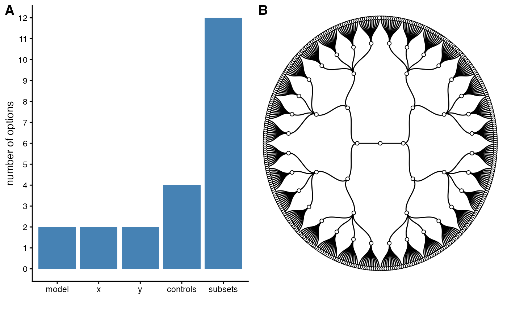
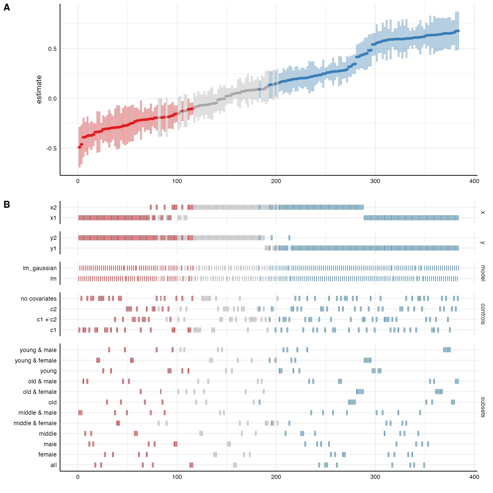
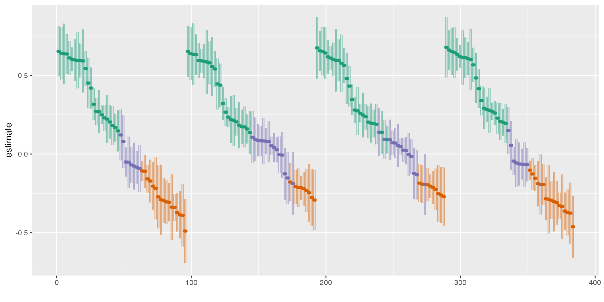
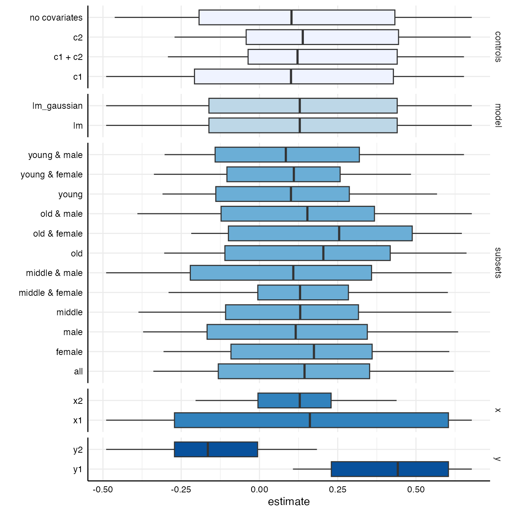
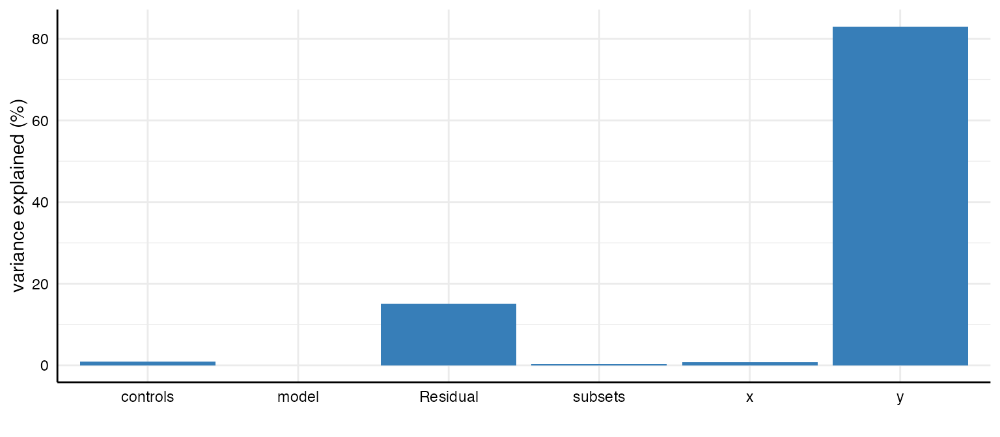

# An introduction to specr

The following vignette is a more comprehensive version of the short
example on the homepage and exemplifies how to use the core functions of
this package. Although using specr strictly speaking does not require
any other package, we recommend to also load the
[tidyverse](https://tidyverse.org/) as it provides valuable functions
for data wrangling and adapting outputs from specr functions.
Furthermore, the tidyverse includes
[ggplot2](https://ggplot2.tidyverse.org/) which can be used to modify
the layout of the plots.

\
`# Load library`\
[`library`](https://rdrr.io/r/base/library.html)`(`[`specr`](https://masurp.github.io/specr/)`)`\
[`library`](https://rdrr.io/r/base/library.html)`(`[`ggplot2`](https://ggplot2.tidyverse.org)`)`

## Understanding the data

In order to understand what type of analytical choices exists and how
they could affect a “multiverse” of results, you need to understand your
data set. In a first step, you should hence investigate your data
closely. For this example, we are going to use a simulated data set
(included in specr).

\
`# We have a look at the simulated data set that is included in the package`\
[`head`](https://rdrr.io/r/utils/head.html)`(``example_data``)`\
`#> ``# A tibble: 6 × 15`\
`#>   group1 group2 group3     x1      x2      x3     x4     c1      c2     c3`\
`#>   ``<chr>``  ``<chr>``  ``<chr>``   ``<dbl>``   ``<dbl>``   ``<dbl>``  ``<dbl>``  ``<dbl>``   ``<dbl>``  ``<dbl>`\
`#> ``1`` middle female C       1.17  -``0.363``  -``0.999``  -``0.293``  0.736  0.171   0.244`\
`#> ``2`` middle male   B       0.765  0.034``9``  0.129  -``0.155`` -``0.720``  0.016``5`` -``0.771`\
`#> ``3`` old    female A      -``2.33``  -``0.998``  -``1.11``   -``1.27``   0.104 -``2.90``   -``6.95`` `\
`#> ``4`` old    female B      -``0.507`` -``0.970``  -``0.086``7`` -``0.978``  1.79  -``0.138``  -``0.431`\
`#> ``5`` old    male   A      -``0.999``  0.546   0.901   2.57  -``0.245``  2.02    2.83 `\
`#> ``6`` middle male   A      -``0.177`` -``1.37``    0.094``7`` -``2.53``   0.315 -``0.688``  -``1.33`` `\
`#> ``# ℹ 5 more variables: c4 <dbl>, y1 <dbl>, y2 <dbl>, y3 <dbl>, y4 <dbl>`

In this example, we assume that `x` represents independent variables,
`y` represents dependent variables, `c` represents control variables,
and `group` denotes potential grouping variables that can be used for
subsetting the data. The independent variables should be numeric, as
specr extracts the estimate of the term that equals `x` (factors would
result in terms such as “xB”; recode them as dummy variables instead).
Grouping variables, in contrast, can be character, factor, or numeric
variables.

## Defining analytical choices

The next step involves setting up all specifications. This step involves
an in-depth understanding of the research question and the model(s) that
will be specified. In this case, we assume simply that `x` should be
positively correlated with `y`. We use the function
[`setup()`](https://masurp.github.io/specr/reference/setup.md) to
specify different analytical decisions.

One type of analytical choice that could additionally affect the results
refers to the type of model that is estimated. The function runs
traditional linear regression models by default (i.e. when
`model = "lm"` is provided as argument). However, customized model
functions can be passed to the function, too. The only requirement is
that the customized function has `formula` and `data` as argument names.
The self-made function needs to be a model estimation function, that
takes the formula and estimates the model based on the data.

Once we have specified all analytic decisions, we run the function and
save the results in the object `specs`. We can then use the summary
function to get a quick overview of the multiverse.

\
`# specific model fitting function`\
`lm_gaussian`` ``<-`` ``function``(``formula``, ``data``)`` ``{`\
`  `[`glm`](https://rdrr.io/r/stats/glm.html)`(``formula ``=`` ``formula``, `\
`      data ``=`` ``data``, `\
`      family ``=`` `[`gaussian`](https://rdrr.io/r/stats/family.html)`(``link ``=`` ``"identity"``)``)`\
`}`\
\
`# Specifying the analytic decisions`\
`specs`` ``<-`` `[`setup`](https://masurp.github.io/specr/reference/setup.md)`(``data ``=`` ``example_data``,            ``# First, we provide the data set`\
`               y ``=`` `[`c`](https://rdrr.io/r/base/c.html)`(``"y1"``, ``"y2"``)``,              ``# Two dependent variables`\
`               x ``=`` `[`c`](https://rdrr.io/r/base/c.html)`(``"x1"``, ``"x2"``)``,              ``# Two independent variables`\
`               model ``=`` `[`c`](https://rdrr.io/r/base/c.html)`(``"lm"``, ``"lm_gaussian"``)``, ``# We estimate two types of models`\
`               controls ``=`` `[`c`](https://rdrr.io/r/base/c.html)`(``"c1"``, ``"c2"``)``,       ``# We include two control variables`\
`               subsets ``=`` `[`list`](https://rdrr.io/r/base/list.html)`(``group1 ``=`` `[`unique`](https://rdrr.io/r/base/unique.html)`(``example_data``$``group1``)``,  ``# Subset 1`\
`                              group2 ``=`` `[`unique`](https://rdrr.io/r/base/unique.html)`(``example_data``$``group2``)``)``)`` ``# Subset 2`\
`                      `\
\
`# Overview of the specifications/multiverse`\
[`summary`](https://rdrr.io/r/base/summary.html)`(``specs``, rows ``=`` ``20``)`\
`#> Setup for the Specification Curve Analysis`\
`#> -------------------------------------------`\
`#> Class:                      specr.setup -- version: 1.1.0 `\
`#> Number of specifications:   384 `\
`#> `\
`#> Specifications:`\
`#> `\
`#>   Independent variable:     x1, x2 `\
`#>   Dependent variable:       y1, y2 `\
`#>   Models:                   lm, lm_gaussian `\
`#>   Covariates:               no covariates, c1, c2, c1 + c2 `\
`#>   Subsets analyses:         middle & female, old & female, young & female, female, middle & male, old & male, young & male, male, middle, old, young, all `\
`#> `\
`#> Function used to extract parameters:`\
`#> `\
`#>   function (x) `\
`#> broom::tidy(x, conf.int = TRUE)`\
`#> <environment: namespace:specr>`\
`#> `\
`#> `\
`#> Head of specifications table (first 20 rows):`\
`#> `\
`#> ``# A tibble: 20 × 8`\
`#>    x     y     model controls      subsets         group1 group2 formula     `\
`#>    ``<chr>`` ``<chr>`` ``<chr>`` ``<chr>``         ``<chr>``           ``<fct>``  ``<fct>``  ``<glue>``      `\
`#> `` 1`` x1    y1    lm    no covariates middle & female middle female y1 ~ x1 + 1 `\
`#> `` 2`` x1    y1    lm    no covariates old & female    old    female y1 ~ x1 + 1 `\
`#> `` 3`` x1    y1    lm    no covariates young & female  young  female y1 ~ x1 + 1 `\
`#> `` 4`` x1    y1    lm    no covariates female          ``NA``     female y1 ~ x1 + 1 `\
`#> `` 5`` x1    y1    lm    no covariates middle & male   middle male   y1 ~ x1 + 1 `\
`#> `` 6`` x1    y1    lm    no covariates old & male      old    male   y1 ~ x1 + 1 `\
`#> `` 7`` x1    y1    lm    no covariates young & male    young  male   y1 ~ x1 + 1 `\
`#> `` 8`` x1    y1    lm    no covariates male            ``NA``     male   y1 ~ x1 + 1 `\
`#> `` 9`` x1    y1    lm    no covariates middle          middle ``NA``     y1 ~ x1 + 1 `\
`#> ``10`` x1    y1    lm    no covariates old             old    ``NA``     y1 ~ x1 + 1 `\
`#> ``11`` x1    y1    lm    no covariates young           young  ``NA``     y1 ~ x1 + 1 `\
`#> ``12`` x1    y1    lm    no covariates all             ``NA``     ``NA``     y1 ~ x1 + 1 `\
`#> ``13`` x1    y1    lm    c1            middle & female middle female y1 ~ x1 + c1`\
`#> ``14`` x1    y1    lm    c1            old & female    old    female y1 ~ x1 + c1`\
`#> ``15`` x1    y1    lm    c1            young & female  young  female y1 ~ x1 + c1`\
`#> ``16`` x1    y1    lm    c1            female          ``NA``     female y1 ~ x1 + c1`\
`#> ``17`` x1    y1    lm    c1            middle & male   middle male   y1 ~ x1 + c1`\
`#> ``18`` x1    y1    lm    c1            old & male      old    male   y1 ~ x1 + c1`\
`#> ``19`` x1    y1    lm    c1            young & male    young  male   y1 ~ x1 + c1`\
`#> ``20`` x1    y1    lm    c1            male            ``NA``     male   y1 ~ x1 + c1`

The resulting S3 class (“specr.setup”) includes a data frame with 384
different specifications. We can also see that the analysis will use the
function `tidy()` from the [broom](https://broom.tidymodels.org/)
package to extract parameters from the models.

We can also get a “visual summary” of the specifications and the
resulting “garden of forking paths” using the generic
[`plot()`](https://rdrr.io/r/graphics/plot.default.html) function.

\
[`plot`](https://rdrr.io/r/graphics/plot.default.html)`(``specs``, circular ``=`` ``TRUE``)`

## Fit models across specifications

The main function of the package is
[`specr()`](https://masurp.github.io/specr/reference/specr.md). We
simply pass the `specs`-object created above (to fit the models in
parallel, see
[`vignette("parallelization")`](https://masurp.github.io/specr/articles/parallelization.md)).
A good first check is to use the
[`summary()`](https://rdrr.io/r/base/summary.html) function to get an
overview of results.

\
`# Run specification curve analysis`\
`results`` ``<-`` `[`specr`](https://masurp.github.io/specr/reference/specr.md)`(``specs``)``  `\
\
`# Summarize results`\
[`summary`](https://rdrr.io/r/base/summary.html)`(``results``)`\
`#> Results of the specification curve analysis`\
`#> -------------------`\
`#> Technical details:`\
`#> `\
`#>   Class:                          specr.object -- version: 1.1.0 `\
`#>   Cores used:                     1 `\
`#>   Duration of fitting process:    1.351 sec elapsed `\
`#>   Number of specifications:       384 `\
`#> `\
`#> Descriptive summary of the specification curve:`\
`#> `\
`#>  median  mad   min  max   q25  q75`\
`#>    0.13 0.45 -0.49 0.68 -0.16 0.44`\
`#> `\
`#> Descriptive summary of sample sizes: `\
`#> `\
`#>  median min  max`\
`#>     250 160 1000`\
`#> `\
`#> Head of the specification results (first 6 rows): `\
`#> `\
`#> ``# A tibble: 6 × 28`\
`#>   x     y     model controls    subsets group1 group2 formula estimate std.error`\
`#>   ``<chr>`` ``<chr>`` ``<chr>`` ``<chr>``       ``<chr>``   ``<fct>``  ``<fct>``  ``<glue>``     ``<dbl>``     ``<dbl>`\
`#> ``1`` x1    y1    lm    no covaria… middle… middle female y1 ~ x…     0.6       0.1 `\
`#> ``2`` x1    y1    lm    no covaria… old & … old    female y1 ~ x…     0.65      0.08`\
`#> ``3`` x1    y1    lm    no covaria… young … young  female y1 ~ x…     0.48      0.08`\
`#> ``4`` x1    y1    lm    no covaria… female  ``NA``     female y1 ~ x…     0.61      0.05`\
`#> ``5`` x1    y1    lm    no covaria… middle… middle male   y1 ~ x…     0.61      0.09`\
`#> ``6`` x1    y1    lm    no covaria… old & … old    male   y1 ~ x…     0.68      0.1 `\
`#> ``# ℹ 18 more variables: statistic <dbl>, p.value <dbl>, conf.low <dbl>,`\
`#> ``#   conf.high <dbl>, fit_r.squared <dbl>, fit_adj.r.squared <dbl>,`\
`#> ``#   fit_sigma <dbl>, fit_statistic <dbl>, fit_p.value <dbl>, fit_df <dbl>,`\
`#> ``#   fit_logLik <dbl>, fit_AIC <dbl>, fit_BIC <dbl>, fit_deviance <dbl>,`\
`#> ``#   fit_df.residual <dbl>, fit_nobs <dbl>, fit_null.deviance <dbl>,`\
`#> ``#   fit_df.null <dbl>`

The resulting S3 class (“specr.object”) includes relevant aspects of the
specification curve analysis and a tibble that includes results for all
specifications. We get a short descriptive summary of the specification
curve, the sample sizes and an overview of the first 6 rows of the
actual results.

## Investigating the specification curve

To investigate the results, we can use some generic functions. The
simple [`summary()`](https://rdrr.io/r/base/summary.html) function has
some additional functionality that we can exploit here.

\
`# basic descriptive summary of the entire specification curve`\
[`summary`](https://rdrr.io/r/base/summary.html)`(``results``, `\
`        type ``=`` ``"curve"``)`\
`#> ``# A tibble: 1 × 7`\
`#>   median   mad    min   max    q25   q75   obs`\
`#>    ``<dbl>`` ``<dbl>``  ``<dbl>`` ``<dbl>``  ``<dbl>`` ``<dbl>`` ``<dbl>`\
`#> ``1``  0.129 0.452 -``0.490`` 0.678 -``0.161`` 0.440   250`\
\
`# basic descriptive summary per specific choices`\
[`summary`](https://rdrr.io/r/base/summary.html)`(``results``, `\
`        type ``=`` ``"curve"``, `\
`        group ``=`` `[`c`](https://rdrr.io/r/base/c.html)`(``"x"``, ``"controls"``)``)``  ``# group analysis by choices`\
`#> ``# A tibble: 8 × 9`\
`#>   x     controls      median    mad      min   max     q25   q75   obs`\
`#>   ``<chr>`` ``<chr>``          ``<dbl>``  ``<dbl>``    ``<dbl>`` ``<dbl>``   ``<dbl>`` ``<dbl>`` ``<dbl>`\
`#> ``1`` x1    c1             0.117 0.709  -``0.490``   0.653 -``0.314``  0.600   250`\
`#> ``2`` x1    c1 + c2        0.160 0.595  -``0.292``   0.653 -``0.213``  0.591   250`\
`#> ``3`` x1    c2             0.178 0.609  -``0.271``   0.675 -``0.197``  0.604   250`\
`#> ``4`` x1    no covariates  0.146 0.699  -``0.462``   0.678 -``0.314``  0.616   250`\
`#> ``5`` x2    c1             0.101 0.251  -``0.204``   0.420 -``0.085``5`` 0.224   250`\
`#> ``6`` x2    c1 + c2        0.122 0.097``0`` -``0.006``48`` 0.438  0.080``9`` 0.207   250`\
`#> ``7`` x2    c2             0.138 0.130  -``0.015``4``  0.432  0.066``3`` 0.240   250`\
`#> ``8`` x2    no covariates  0.102 0.251  -``0.194``   0.415 -``0.066``9`` 0.263   250`\
\
`# basic descriptive summary with other statistics`\
[`summary`](https://rdrr.io/r/base/summary.html)`(``results``, `\
`        type ``=`` ``"curve"``, `\
`        group ``=`` ``"subsets"``, `\
`        stats ``=`` `[`list`](https://rdrr.io/r/base/list.html)`(``mean ``=`` ``mean``, `\
`                     median ``=`` ``median``)``)`\
`#> ``# A tibble: 12 × 4`\
`#>    subsets           mean median   obs`\
`#>    ``<chr>``            ``<dbl>``  ``<dbl>`` ``<dbl>`\
`#> `` 1`` all             0.140  0.144   ``1``000`\
`#> `` 2`` female          0.157  0.174    500`\
`#> `` 3`` male            0.125  0.116    500`\
`#> `` 4`` middle          0.125  0.130    331`\
`#> `` 5`` middle & female 0.149  0.130    168`\
`#> `` 6`` middle & male   0.091``0`` 0.108    163`\
`#> `` 7`` old             0.184  0.204    323`\
`#> `` 8`` old & female    0.225  0.255    163`\
`#> `` 9`` old & male      0.147  0.153    160`\
`#> ``10`` young           0.112  0.101    346`\
`#> ``11`` young & female  0.086``9`` 0.110    169`\
`#> ``12`` young & male    0.135  0.084``2``   177`

The output contains summary statistics such as the median, the median
absolute deviation, … as well as the number of observations that were
used for each model. Bear in mind that due to subsetting or missing
data, sample sizes can vary considerably which, in turn, affects the
results.

## Visualizing results

However, in order to grasp how the different analytical choices affect
the outcome of interest (in this case, the estimate refers to the
unstandardized regression coefficient *b*), it is reasonable to plot a
specification curve. The generic function
[`plot()`](https://rdrr.io/r/graphics/plot.default.html) can be used to
produce the typical visualization of the specification curve and how the
analytical choices affected the obtained results.

\
`# Plot entire visualization`\
[`plot`](https://rdrr.io/r/graphics/plot.default.html)`(``results``)`

The resulting plot includes the ranked specification curve (A) and an
overview about how the different analytical choices affect the estimate
of interest (B). Red represents negative and significant effects (based
on the chosen significance level, by default $`\alpha = .05`$). Blue
represents positive and significant effects. Grey refers to
non-significant effects.

We can also just plot the curve and adjust the style and layout using
ggplot2 functions. Here, I also order the curve by control variables and
rank them in a descending order.

\
`# Plot `\
[`plot`](https://rdrr.io/r/graphics/plot.default.html)`(``results``, type ``=`` ``"curve"``, group ``=`` ``controls``, desc ``=`` ``TRUE``)`` ``+`\
`  `[`scale_color_brewer`](https://ggplot2.tidyverse.org/reference/scale_brewer.html)`(``palette ``=`` ``"Dark2"``)`` ``+`\
`  `[`theme_grey`](https://ggplot2.tidyverse.org/reference/ggtheme.html)`(``)`` ``+`\
`  `[`theme`](https://ggplot2.tidyverse.org/reference/theme.html)`(``legend.position ``=`` ``"none"``)`

Sometimes, it can be useful to check the influence of specific choices
on the estimate of interest more precisely. We can again use the generic
function [`plot()`](https://rdrr.io/r/graphics/plot.default.html) to
produce respective boxplots.

\
[`plot`](https://rdrr.io/r/graphics/plot.default.html)`(``results``, type ``=`` ``"boxplot"``)`

We can see that the dependent variable (`y`) produces the largest
differences in the obtained estimates.

## Decomposing the variance in the specification curve

Finally, we can estimate how much variance in the specification curve is
related to which analytical decisions. We again can simply use the
[`plot()`](https://rdrr.io/r/graphics/plot.default.html) function with
the argument `type = "variance"` and receive a barplot that shows which
analytical choice accounts for which amount of variance in the curve.

\
[`plot`](https://rdrr.io/r/graphics/plot.default.html)`(``results``, type ``=`` ``"variance"``)`\
`#>        grp vcov  icc percent`\
`#> 1  subsets 0.00 0.00    0.28`\
`#> 2 controls 0.00 0.01    0.87`\
`#> 3    model 0.00 0.00    0.00`\
`#> 4        y 0.16 0.83   83.01`\
`#> 5        x 0.00 0.01    0.73`\
`#> 6 Residual 0.03 0.15   15.11`

