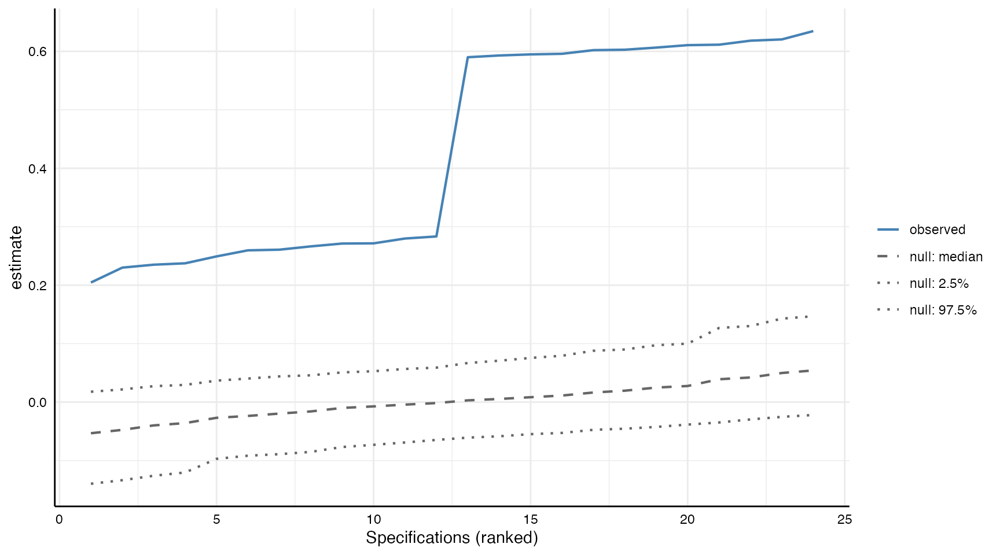
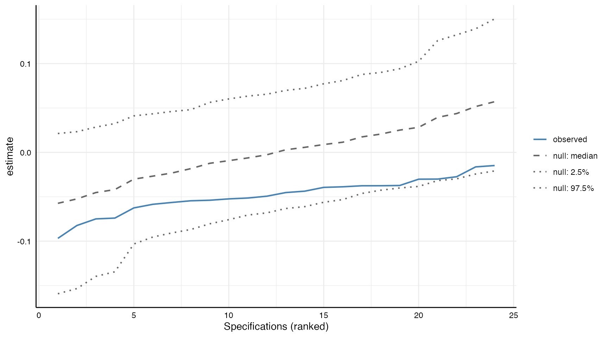

# Inference with specification curve analysis

In their paper, Simonsohn et al. (2020) propose a third step within the
logic of specification curve analysis, which refers to conducting
inference tests across the entire range of the specification curve. This
step aims to address the following question: *Considering the full set
of reasonable specifications jointly, how inconsistent are the results
with the null hypothesis of no effect?*

We have been contemplating the implementation of this third step in our
package. Until recently, we have concluded that there remains
significant uncertainty regarding when such joint inferences are
appropriate (see, for example, the recent discussion by Del Giudice &
Gangestad, 2021), who highlight:

> “In principle, multiverse-style analyses can be highly instructive. At
> the same time, analyses that explore multiverse spaces that are not
> homogeneous can produce misleading results and interpretations, lead
> scholars to dismiss the robustness of theoretically important findings
> that do exist, and discourage them from following fruitful avenues of
> research. This can hinder scientific progress just as much as the
> proliferation of false, unreplicable findings does” (p. 2).

The issue is as follows: Multiverse or specification curve analyses can
serve different purposes. In the simplest form, it may serve to explore
and discover differences in effect sizes that relate to specific
theoretical or analytical decisions. Yet, the method is also suggestive
of being a “somehow better approach to testing a relationship”. The aim
of this second purpose, which is akin to a robustness test, is to
exhaust the multiverse of truly arbitrary decisions in order to gain
some sort of aggregate finding that can be use to refute or support a
hypothesis. As Del Giudice and Gangestad point out very convincingly,
however, it is often not straight-forward to decide whether
specification is truly arbitrary (or in their terms: exhibits principled
equivalence) compared to another specification. Yet, if this is not the
case, running any inference tests is futile as “Just a few decisions
incorrectly treated as arbitrary can quickly explode the size of the
multiverse, drowning reasonable effect estimates in a sea of unjustified
alternatives.” (Del Giudice & Gangestad, 2021, p. 2).

For these reasons, we have been, and continue to be, concerned that
tools for such an inference test could be misused or lead to improperly
conducted robustness tests. Nevertheless, due to frequent inquiries, we
have integrated a function called
[`infer_curve()`](https://masurp.github.io/specr/reference/infer_curve.md)
in `specr` (since version 1.1.0). It implements the procedure described
in the section “Inference with non-experimental data” of the paper by
Simonsohn et al. (2020).

## How it works

The idea behind this inference approach is that one forces the null on
the data: for non-experimental data, Simonsohn et al. (2020, p. 1213)
propose to modify the dependent variable of each specification such that
the estimated effect becomes exactly zero, and then to draw bootstrap
samples from these modified data. As the null hypothesis is true in
these data by construction, the specification curves estimated in the
bootstrap samples show what the curve would look like if there were no
effect.

In
[`infer_curve()`](https://masurp.github.io/specr/reference/infer_curve.md),
this works as follows:

1.  For every specification $`k`$, the dependent variable is modified so
    that the null hypothesis is true by construction:
    $`y^*_k = y_k - b_k x_k`$, where $`b_k`$ is the estimate observed in
    that specification. Each specification thus gets its own modified
    dependent variable.
2.  $`N`$ rows are drawn at random with replacement from the data set
    (with $`N`$ being the number of rows of the data set). The same rows
    are used for all specifications, which preserves the dependence
    between them.
3.  Every specification is refitted on these rows with $`y^*_k`$ as its
    dependent variable. Each specification keeps its own model, control
    variables, subset, and additions to the formula.
4.  Steps 2 and 3 are repeated many times (e.g., 1,000 times). This
    produces a distribution of specification curves that would be
    expected if all specifications had a true effect of zero.

Based on these curves, the observed specification curve can be tested
with three test statistics:

1.  The **median** effect estimated across all specifications: is it
    more extreme than would be expected if all specifications had a true
    effect of zero?
2.  The **share of specifications that obtain a statistically
    significant effect** in the predicted direction: is it more extreme
    (higher) than would be expected if all specifications had an effect
    of zero?
3.  The **aggregated z-value** (Stouffer’s Z), which combines the
    p-values of all specifications: is it more extreme than would be
    expected if all specifications had an effect of zero?

Because the null is imposed by subtracting $`b_k x_k`$ from the
dependent variable, this procedure requires models that are linear in
the dependent variable (e.g., `lm`, `lmer`, or `glm` with a gaussian
family), numeric independent and dependent variables, and unstandardized
estimates.
[`infer_curve()`](https://masurp.github.io/specr/reference/infer_curve.md)
checks this before resampling (by refitting every specification on its
modified dependent variable, which has to yield an estimate of zero) and
stops otherwise. For example, logistic regression models or structural
equation models are not supported.

## Preparations

### Loading packages and data

\
`# Load packages`\
[`library`](https://rdrr.io/r/base/library.html)`(`[`specr`](https://masurp.github.io/specr/)`)`\
[`library`](https://rdrr.io/r/base/library.html)`(`[`tidyverse`](https://tidyverse.tidyverse.org)`)`

For this tutorial, we will simply use the data set included in the
package, which we can call using `example_data`.

\
[`glimpse`](https://pillar.r-lib.org/reference/glimpse.html)`(``example_data``)`\
`#> Rows: 1,000`\
`#> Columns: 15`\
`#> $ group1 ``<chr>`` "middle"``, ``"middle"``, ``"old"``, ``"old"``, ``"old"``, ``"middle"``, ``"middle"``, ``"y…`\
`#> $ group2 ``<chr>`` "female"``, ``"male"``, ``"female"``, ``"female"``, ``"male"``, ``"male"``, ``"male"``, ``"…`\
`#> $ group3 ``<chr>`` "C"``, ``"B"``, ``"A"``, ``"B"``, ``"A"``, ``"A"``, ``"C"``, ``"B"``, ``"C"``, ``"A"``, ``"C"``, ``"B"``, ``"A"…`\
`#> $ x1     ``<dbl>`` 1.16616502``, ``0.76481253``, ``-2.32781072``, ``-0.50729975``, ``-0.99903467``, ``…`\
`#> $ x2     ``<dbl>`` -0.36337844``, ``0.03490195``, ``-0.99786005``, ``-0.97004472``, ``0.54629183``, ``…`\
`#> $ x3     ``<dbl>`` -0.99899919``, ``0.12896300``, ``-1.11167238``, ``-0.08670481``, ``0.90082978``, ``…`\
`#> $ x4     ``<dbl>`` -0.29290911``, ``-0.15539508``, ``-1.27298782``, ``-0.97830572``, ``2.56842916``,``…`\
`#> $ c1     ``<dbl>`` 0.73628873``, ``-0.72031278``, ``0.10362937``, ``1.78665608``, ``-0.24463403``, ``0…`\
`#> $ c2     ``<dbl>`` 0.17137360``, ``0.01651493``, ``-2.89579197``, ``-0.13769598``, ``2.02092928``, ``-…`\
`#> $ c3     ``<dbl>`` 0.2438919``, ``-0.7708723``, ``-6.9505025``, ``-0.4307226``, ``2.8327862``, ``-1.32…`\
`#> $ c4     ``<dbl>`` 1.17397012``, ``0.00271097``, ``0.11513596``, ``0.84856292``, ``-1.40719578``, ``0.…`\
`#> $ y1     ``<dbl>`` -0.83896230``, ``-1.19442262``, ``-1.63184657``, ``0.20794834``, ``-1.06889092``,``…`\
`#> $ y2     ``<dbl>`` -1.15339449``, ``-1.40708441``, ``0.46620798``, ``0.17421825``, ``2.89071414``, ``2…`\
`#> $ y3     ``<dbl>`` -0.20911315``, ``0.17605870``, ``-1.07664735``, ``-0.37805585``, ``-0.35389962``,``…`\
`#> $ y4     ``<dbl>`` -0.10135448``, ``-0.08908509``, ``-0.27064865``, ``0.73415456``, ``-0.20267287``,``…`

### Setup specifications and run the specification curve analysis

We first run a standard specification curve analysis using the functions
[`setup()`](https://masurp.github.io/specr/reference/setup.md) and
[`specr()`](https://masurp.github.io/specr/reference/specr.md). In this
example, we investigate the relationship between two independent
variables (`x1` and `x2`, e.g., two alternative measures of the same
construct) and the dependent variable `y1`, with different combinations
of two control variables and in different subsets of the data.

\
`specs`` ``<-`` `[`setup`](https://masurp.github.io/specr/reference/setup.md)`(``data ``=`` ``example_data``,`\
`   y ``=`` ``"y1"``,`\
`   x ``=`` `[`c`](https://rdrr.io/r/base/c.html)`(``"x1"``, ``"x2"``)``,`\
`   model ``=`` ``"lm"``,`\
`   controls ``=`` `[`c`](https://rdrr.io/r/base/c.html)`(``"c1"``, ``"c2"``)``,`\
`   subsets ``=`` `[`list`](https://rdrr.io/r/base/list.html)`(``group2 ``=`` `[`c`](https://rdrr.io/r/base/c.html)`(``"female"``, ``"male"``)``)``)`\
\
`results`` ``<-`` `[`specr`](https://masurp.github.io/specr/reference/specr.md)`(``specs``)`\
[`summary`](https://rdrr.io/r/base/summary.html)`(``results``)`\
`#> Results of the specification curve analysis`\
`#> -------------------`\
`#> Technical details:`\
`#> `\
`#>   Class:                          specr.object -- version: 1.1.0 `\
`#>   Cores used:                     1 `\
`#>   Duration of fitting process:    0.069 sec elapsed `\
`#>   Number of specifications:       24 `\
`#> `\
`#> Descriptive summary of the specification curve:`\
`#> `\
`#>  median  mad min  max  q25 q75`\
`#>    0.44 0.26 0.2 0.63 0.26 0.6`\
`#> `\
`#> Descriptive summary of sample sizes: `\
`#> `\
`#>  median min  max`\
`#>     500 500 1000`\
`#> `\
`#> Head of the specification results (first 6 rows): `\
`#> `\
`#> ``# A tibble: 6 × 25`\
`#>   x     y     model controls subsets group2 formula estimate std.error statistic`\
`#>   ``<chr>`` ``<chr>`` ``<chr>`` ``<chr>``    ``<chr>``   ``<fct>``  ``<glue>``     ``<dbl>``     ``<dbl>``     ``<dbl>`\
`#> ``1`` x1    y1    lm    no cova… female  female y1 ~ x…     0.61      0.05      11.2`\
`#> ``2`` x1    y1    lm    no cova… male    male   y1 ~ x…     0.63      0.05      12.0`\
`#> ``3`` x1    y1    lm    no cova… all     ``NA``     y1 ~ x…     0.62      0.04      16.4`\
`#> ``4`` x1    y1    lm    c1       female  female y1 ~ x…     0.59      0.06      10.8`\
`#> ``5`` x1    y1    lm    c1       male    male   y1 ~ x…     0.61      0.05      11.2`\
`#> ``6`` x1    y1    lm    c1       all     ``NA``     y1 ~ x…     0.6       0.04      15.6`\
`#> ``# ℹ 15 more variables: p.value <dbl>, conf.low <dbl>, conf.high <dbl>,`\
`#> ``#   fit_r.squared <dbl>, fit_adj.r.squared <dbl>, fit_sigma <dbl>,`\
`#> ``#   fit_statistic <dbl>, fit_p.value <dbl>, fit_df <dbl>, fit_logLik <dbl>,`\
`#> ``#   fit_AIC <dbl>, fit_BIC <dbl>, fit_deviance <dbl>, fit_df.residual <dbl>,`\
`#> ``#   fit_nobs <dbl>`

So far, nothing new. We get the results of the specification curve
analysis and can explore them descriptively or visually.

## Refit the models under-the-null

### Run the resampling procedure

To run the procedure, we simply use the function
[`infer_curve()`](https://masurp.github.io/specr/reference/infer_curve.md),
which requires the results, the specification setup (or the data set),
and the number of bootstrap samples that should be drawn. Simonsohn et
al. (2020) use 500 samples. Here, we use 1,000 samples, which is a
reasonable minimum for results that are reported. As the procedure
relies on random sampling, we set a seed to make the results
reproducible.

\
[`set.seed`](https://rdrr.io/r/base/Random.html)`(``42``)`\
`inference`` ``<-`` `[`infer_curve`](https://masurp.github.io/specr/reference/infer_curve.md)`(``results``, ``specs``, n_samples ``=`` ``1000``)`\
`inference`\
`#> Inference on the specification curve (resampling under the null)`\
`#> -------------------`\
`#> Technical details:`\
`#> `\
`#>   Class:                           specr.infer -- version: 1.1.0 `\
`#>   Cores used:                      1 `\
`#>   Duration of fitting process:     0.905 sec elapsed `\
`#>   Number of specifications:        24 `\
`#>   Number of bootstrap samples:     1000 `\
`#> `\
`#> Test statistics (two-sided, see ?summary.specr.infer):`\
`#> `\
`#> ``# A tibble: 3 × 6`\
`#>   statistic                    estimate null_lower null_upper  p.value n_specs`\
`#>   ``<chr>``                           ``<dbl>``      ``<dbl>``      ``<dbl>``    ``<dbl>``   ``<int>`\
`#> ``1`` median                          0.437    -``0.063``6``     0.062``1`` 0.000``999``      24`\
`#> ``2`` share significant (positive)   24         0         10      0.000``999``      24`\
`#> ``3`` aggregated z                   45.6      -``7.57``       6.86   0.000``999``      24`

For specifications fitted with `lm`,
[`infer_curve()`](https://masurp.github.io/specr/reference/infer_curve.md)
uses a fast least-squares routine that gives the same results as
[`lm()`](https://rdrr.io/r/stats/lm.html), so that even several thousand
bootstrap samples only take a few seconds. Other models are refitted
with their original model function, which takes longer. In this case,
the resampling can be parallelized by setting up a plan before running
[`infer_curve()`](https://masurp.github.io/specr/reference/infer_curve.md)
(see
[`vignette("parallelization")`](https://masurp.github.io/specr/articles/parallelization.md)),
e.g.:

\
[`library`](https://rdrr.io/r/base/library.html)`(`[`furrr`](https://github.com/futureverse/furrr)`)`\
[`plan`](https://future.futureverse.org/reference/plan.html)`(``multisession``, workers ``=`` ``4``)`\
`inference`` ``<-`` `[`infer_curve`](https://masurp.github.io/specr/reference/infer_curve.md)`(``results``, ``specs``, n_samples ``=`` ``1000``)`\
[`plan`](https://future.futureverse.org/reference/plan.html)`(``sequential``)`

The results are identical whether they are computed sequentially or in
parallel.

### Summarize findings

The test statistics are obtained by using the generic function
[`summary()`](https://rdrr.io/r/base/summary.html) around the resulting
object:

\
[`summary`](https://rdrr.io/r/base/summary.html)`(``inference``)`\
`#> ``# A tibble: 3 × 6`\
`#>   statistic                    estimate null_lower null_upper  p.value n_specs`\
`#>   ``<chr>``                           ``<dbl>``      ``<dbl>``      ``<dbl>``    ``<dbl>``   ``<int>`\
`#> ``1`` median                          0.437    -``0.063``6``     0.062``1`` 0.000``999``      24`\
`#> ``2`` share significant (positive)   24         0         10      0.000``999``      24`\
`#> ``3`` aggregated z                   45.6      -``7.57``       6.86   0.000``999``      24`

For each test statistic, the output shows the observed value
(`estimate`), the range in which 95% of the values under the null fall
(`null_lower` and `null_upper`), and the p-value, i.e., the share of
curves under the null whose statistic is at least as extreme as the
observed one. Here, the observed median estimate is 0.44, whereas 95% of
the medians under the null lie between -0.06 and 0.06. Similarly, 24 of
24 specifications obtain a significant positive effect, which is more
than would be expected if all specifications had a true effect of zero.
Not a single curve under the null was as extreme as the observed curve,
so all p-values are at their minimum of 1 / (1 + 1,000).

By default, the tests are two-sided. If the direction of the effect was
predicted before the results were known, one-sided tests can be obtained
with the argument `direction`:

\
[`summary`](https://rdrr.io/r/base/summary.html)`(``inference``, direction ``=`` ``"greater"``)`\
`#> ``# A tibble: 3 × 6`\
`#>   statistic                    estimate null_lower null_upper  p.value n_specs`\
`#>   ``<chr>``                           ``<dbl>``      ``<dbl>``      ``<dbl>``    ``<dbl>``   ``<int>`\
`#> ``1`` median                          0.437    -``0.063``6``     0.062``1`` 0.000``999``      24`\
`#> ``2`` share significant (positive)   24         0          8      0.000``999``      24`\
`#> ``3`` aggregated z                   45.6      -``7.57``       6.86   0.000``999``      24`

The test statistics can also be computed separately for groups of
specifications, e.g., for each independent variable:

\
[`summary`](https://rdrr.io/r/base/summary.html)`(``inference``, group ``=`` ``"x"``)`\
`#> ``# A tibble: 6 × 7`\
`#>   x     statistic                 estimate null_lower null_upper p.value n_specs`\
`#>   ``<chr>`` ``<chr>``                        ``<dbl>``      ``<dbl>``      ``<dbl>``   ``<dbl>``   ``<int>`\
`#> ``1`` x1    median                       0.605    -``0.082``0``     0.084``5`` 9.99``e``-4``      12`\
`#> ``2`` x1    share significant (posit…   12         0          8      9.99``e``-4``      12`\
`#> ``3`` x1    aggregated z                41.4      -``5.93``       5.96   9.99``e``-4``      12`\
`#> ``4`` x2    median                       0.260    -``0.056``6``     0.058``3`` 9.99``e``-4``      12`\
`#> ``5`` x2    share significant (posit…   12         0          6      9.99``e``-4``      12`\
`#> ``6`` x2    aggregated z                23.1      -``5.39``       5.32   9.99``e``-4``      12`

### Plot inference curve

Simonsohn et al. also suggest that the observed specification curve can
be plotted against the expected under-the-null specification curves. In
the figure, the estimates of each curve are ranked from lowest to
highest. The grey lines represent the median as well as the 2.5th and
97.5th percentiles of the ranked curves under the null.

\
[`plot`](https://rdrr.io/r/graphics/plot.default.html)`(``inference``)`

As we can see, the observed curve is clearly different from the curves
that would be expected if the true effect was zero.

## For comparison: no effect in any specification

To illustrate what the results look like if there is no effect, we
shuffle the dependent variable, which removes any relationship between
`y1` and the other variables, and repeat the analysis.

\
[`set.seed`](https://rdrr.io/r/base/Random.html)`(``1``)`\
`shuffled`` ``<-`` ``example_data`\
`shuffled``$``y1`` ``<-`` `[`sample`](https://rdrr.io/r/base/sample.html)`(``shuffled``$``y1``)`\
\
`specs_null`` ``<-`` `[`setup`](https://masurp.github.io/specr/reference/setup.md)`(``data ``=`` ``shuffled``,`\
`   y ``=`` ``"y1"``,`\
`   x ``=`` `[`c`](https://rdrr.io/r/base/c.html)`(``"x1"``, ``"x2"``)``,`\
`   model ``=`` ``"lm"``,`\
`   controls ``=`` `[`c`](https://rdrr.io/r/base/c.html)`(``"c1"``, ``"c2"``)``,`\
`   subsets ``=`` `[`list`](https://rdrr.io/r/base/list.html)`(``group2 ``=`` `[`c`](https://rdrr.io/r/base/c.html)`(``"female"``, ``"male"``)``)``)`\
\
`results_null`` ``<-`` `[`specr`](https://masurp.github.io/specr/reference/specr.md)`(``specs_null``)`\
\
[`set.seed`](https://rdrr.io/r/base/Random.html)`(``42``)`\
`inference_null`` ``<-`` `[`infer_curve`](https://masurp.github.io/specr/reference/infer_curve.md)`(``results_null``, ``specs_null``, n_samples ``=`` ``1000``)`\
[`summary`](https://rdrr.io/r/base/summary.html)`(``inference_null``)`\
`#> ``# A tibble: 3 × 6`\
`#>   statistic                    estimate null_lower null_upper p.value n_specs`\
`#>   ``<chr>``                           ``<dbl>``      ``<dbl>``      ``<dbl>``   ``<dbl>``   ``<int>`\
`#> ``1`` median                        -``0.047``3``    -``0.065``6``     0.066``9``   0.150      24`\
`#> ``2`` share significant (negative)   2          0          9        0.251      24`\
`#> ``3`` aggregated z                  -``5.32``      -``7.02``       6.81     0.128      24`

Now, the observed statistics lie within the range of the statistics
under the null, and the p-values are not significant. Accordingly, the
observed curve lies within the curves under the null (note, however,
that also in data without any effect, about 5% of such analyses yield
p-values below .05 by chance):

\
[`plot`](https://rdrr.io/r/graphics/plot.default.html)`(``inference_null``)`

## A note on earlier development versions

Earlier development versions of `specr` included this procedure under
the name `boot_null()`. That implementation refitted each specification
on too many rows, which made the curves under the null too narrow and
the p-values too small. `boot_null()` was removed in version 1.1.0. If
you used `boot_null()` before, please recompute your results with
[`infer_curve()`](https://masurp.github.io/specr/reference/infer_curve.md).

## References

- Del Giudice, M., & Gangestad, S. W. (2021). A traveler’s guide to the
  multiverse: Promises, pitfalls, and a framework for the evaluation of
  analytic decisions. Advances in Methods and Practices in Psychological
  Science, 4(1),
  <https://journals.sagepub.com/doi/full/10.1177/2515245920954925>.

- Simonsohn, U., Simmons, J.P. & Nelson, L.D. (2020). Specification
  curve analysis. Nature Human Behaviour, 4, 1208–1214.
  <https://doi.org/10.1038/s41562-020-0912-z>
