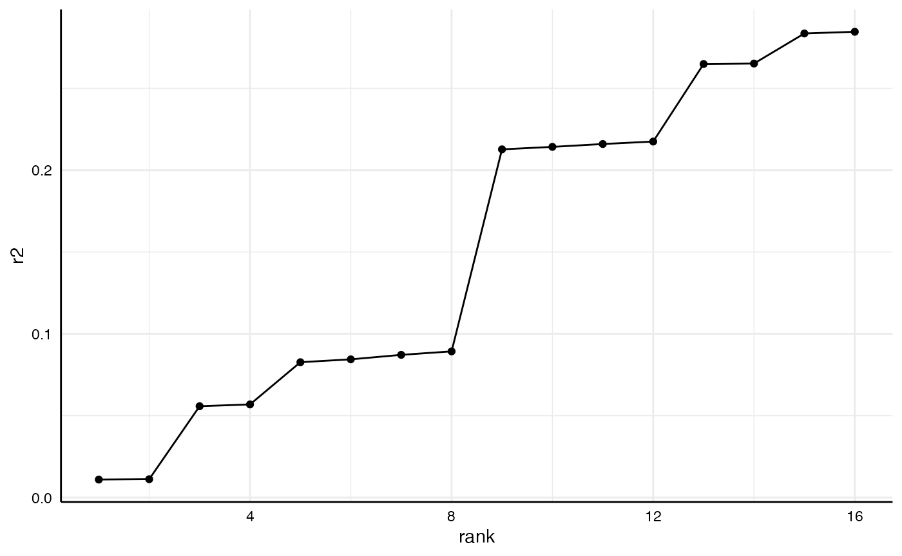

# Investigating specific specifications

Per default,
[`specr()`](https://masurp.github.io/specr/reference/specr.md)
summarizes individual specifications by using
[`broom::tidy()`](https://generics.r-lib.org/reference/tidy.html) and
[`broom::glance()`](https://generics.r-lib.org/reference/glance.html).
For most cases, this provides a sufficient and appropriate summary of
the relationship of interest and model characteristics. Sometimes,
however, it might be useful to investigate specific models in more
detail or to investigate a specific parameter that is not provided by
the two functions (e.g., r-square). This vignette shows how to access
individual models and extract further information from them.

\
[`library`](https://rdrr.io/r/base/library.html)`(`[`tidyverse`](https://tidyverse.tidyverse.org)`)`\
[`library`](https://rdrr.io/r/base/library.html)`(`[`specr`](https://masurp.github.io/specr/)`)`\
[`library`](https://rdrr.io/r/base/library.html)`(`[`performance`](https://easystats.github.io/performance/)`)`

## Setup specifications with a specific extract function

If we want to investigate individual models and particularly all aspects
of that model, we need to create a custom extract function that also
stores the entire model object in the result data frame.

\
`# Custom function`\
`tidy_new`` ``<-`` ``function``(``x``)`` ``{`\
`  ``fit`` ``<-`` ``broom``::`[`tidy`](https://generics.r-lib.org/reference/tidy.html)`(``x``, conf.int ``=`` ``TRUE``)`\
`  ``fit``$``res`` ``<-`` `[`list`](https://rdrr.io/r/base/list.html)`(``x``)``  ``# Store model object`\
`  `[`return`](https://rdrr.io/r/base/function.html)`(``fit``)`\
`}`\
\
`# Run specification curve analysis`\
`specs`` ``<-`` `[`setup`](https://masurp.github.io/specr/reference/setup.md)`(``data ``=`` ``example_data``, `\
`               y ``=`` `[`c`](https://rdrr.io/r/base/c.html)`(``"y1"``, ``"y2"``)``, `\
`               x ``=`` `[`c`](https://rdrr.io/r/base/c.html)`(``"x1"``, ``"x2"``)``, `\
`               model ``=`` `[`c`](https://rdrr.io/r/base/c.html)`(``"lm"``)``,`\
`               controls ``=`` `[`c`](https://rdrr.io/r/base/c.html)`(``"c1"``, ``"c2"``)``,`\
`               subsets ``=`` `[`list`](https://rdrr.io/r/base/list.html)`(``group1 ``=`` `[`unique`](https://rdrr.io/r/base/unique.html)`(``example_data``$``group1``)``,  `\
`                              group2 ``=`` `[`unique`](https://rdrr.io/r/base/unique.html)`(``example_data``$``group2``)``)``,`\
`               fun1 ``=`` ``tidy_new``)`\
\
`results`` ``<-`` `[`specr`](https://masurp.github.io/specr/reference/specr.md)`(``specs``)`

## Identify model(s) of interest

For this example, we are going to look at two specific models (same
independent variables, all controls, all participants, but different
dependent variables).

\
`(``y_models`` ``<-`` ``results`` `[`%>%`](https://magrittr.tidyverse.org/reference/pipe.html)\
`  ``as_tibble`` `[`%>%`](https://magrittr.tidyverse.org/reference/pipe.html)\
`  `[`filter`](https://dplyr.tidyverse.org/reference/filter.html)`(``x`` ``==`` ``"x1"``, `\
`         ``controls`` ``==`` ``"c1 + c2"``,`\
`         ``subsets`` ``==`` ``"all"``)``)`` `[`%>%`](https://magrittr.tidyverse.org/reference/pipe.html)\
`  `[`select`](https://dplyr.tidyverse.org/reference/select.html)`(``x``:``group2``, ``estimate``:``res``)`\
`#> ``# A tibble: 2 × 14`\
`#>   x     y     model controls subsets group1 group2 estimate std.error statistic`\
`#>   ``<chr>`` ``<chr>`` ``<chr>`` ``<chr>``    ``<chr>``   ``<fct>``  ``<fct>``     ``<dbl>``     ``<dbl>``     ``<dbl>`\
`#> ``1`` x1    y1    lm    c1 + c2  all     ``NA``     ``NA``        0.593    0.039``3``     15.1 `\
`#> ``2`` x1    y2    lm    c1 + c2  all     ``NA``     ``NA``       -``0.214``    0.038``9``     -``5.51`\
`#> ``# ℹ 4 more variables: p.value <dbl>, conf.low <dbl>, conf.high <dbl>,`\
`#> ``#   res <list>`

As you can see, the resulting tibble includes an additional column
called `res`. This column includes the entire “model object” and we can
use it to further investigate each model.

## Investigate models

For example, we can now easily get a full summary of the models and
compare individual coefficients and statistics.

\
`y_models`` `[`%>%`](https://magrittr.tidyverse.org/reference/pipe.html)\
`  `[`pull`](https://dplyr.tidyverse.org/reference/pull.html)`(``res``)`` `[`%>%`](https://magrittr.tidyverse.org/reference/pipe.html)\
`  `[`map`](https://purrr.tidyverse.org/reference/map.html)`(``summary``)`` `[`%>%`](https://magrittr.tidyverse.org/reference/pipe.html)\
`  `[`map`](https://purrr.tidyverse.org/reference/map.html)`(``coef``)`\
`#> [[1]]`\
`#>                Estimate Std. Error    t value      Pr(>|t|)`\
`#> (Intercept) -1.09466509 0.03582021 -30.559989 3.127670e-145`\
`#> x1           0.59291826 0.03933279  15.074403  2.084917e-46`\
`#> c1           0.06781034 0.03327698   2.037756  4.183823e-02`\
`#> c2          -0.04278267 0.03079000  -1.389499  1.649916e-01`\
`#> `\
`#> [[2]]`\
`#>                Estimate Std. Error   t value     Pr(>|t|)`\
`#> (Intercept)  0.79394670 0.03540987 22.421621 1.828378e-90`\
`#> x1          -0.21413105 0.03888221 -5.507172 4.640637e-08`\
`#> c1           0.03921893 0.03289578  1.192218 2.334599e-01`\
`#> c2           0.54186302 0.03043728 17.802607 9.085852e-62`

Or we could get r-squared values for both models (here using the
function
[`r2()`](https://easystats.github.io/performance/reference/r2.html) from
the [performance](https://easystats.github.io/performance/) package).

\
`y_models`` `[`%>%`](https://magrittr.tidyverse.org/reference/pipe.html)\
`  `[`pull`](https://dplyr.tidyverse.org/reference/pull.html)`(``res``)`` `[`%>%`](https://magrittr.tidyverse.org/reference/pipe.html)` `\
`  `[`map`](https://purrr.tidyverse.org/reference/map.html)`(``r2``)``       ``# r2 is included in the package "performance"`\
`#> [[1]]`\
`#> # R2 for Linear Regression`\
`#>        R2: 0.217`\
`#>   adj. R2: 0.215`\
`#> `\
`#> [[2]]`\
`#> # R2 for Linear Regression`\
`#>        R2: 0.285`\
`#>   adj. R2: 0.282`

## Some more examples

This way, we can analyze or compare such statistics across several
models.

\
`r2_results`` ``<-`` ``results`` `[`%>%`](https://magrittr.tidyverse.org/reference/pipe.html)\
`  ``as_tibble`` `[`%>%`](https://magrittr.tidyverse.org/reference/pipe.html)\
`  `[`filter`](https://dplyr.tidyverse.org/reference/filter.html)`(``subsets`` ``==`` ``"all"``)`` `[`%>%`](https://magrittr.tidyverse.org/reference/pipe.html)\
`  `[`mutate`](https://dplyr.tidyverse.org/reference/mutate.html)`(``r2 ``=`` `[`map`](https://purrr.tidyverse.org/reference/map.html)`(``res``, ``r2``)``, `\
`         r2 ``=`` `[`map_dbl`](https://purrr.tidyverse.org/reference/map.html)`(``r2``, ``1``)``)`` `[`%>%`](https://magrittr.tidyverse.org/reference/pipe.html)\
`  `[`arrange`](https://dplyr.tidyverse.org/reference/arrange.html)`(``r2``)`\
\
`r2_results`` `[`%>%`](https://magrittr.tidyverse.org/reference/pipe.html)\
`  `[`select`](https://dplyr.tidyverse.org/reference/select.html)`(``x``:``controls``, ``r2``)`\
`#> ``# A tibble: 16 × 5`\
`#>    x     y     model controls          r2`\
`#>    ``<chr>`` ``<chr>`` ``<chr>`` ``<chr>``          ``<dbl>`\
`#> `` 1`` x2    y2    lm    no covariates 0.011``0`\
`#> `` 2`` x2    y2    lm    c1            0.011``2`\
`#> `` 3`` x1    y2    lm    no covariates 0.055``8`\
`#> `` 4`` x1    y2    lm    c1            0.056``9`\
`#> `` 5`` x2    y1    lm    no covariates 0.082``7`\
`#> `` 6`` x2    y1    lm    c2            0.084``4`\
`#> `` 7`` x2    y1    lm    c1            0.087``2`\
`#> `` 8`` x2    y1    lm    c1 + c2       0.089``3`\
`#> `` 9`` x1    y1    lm    no covariates 0.213 `\
`#> ``10`` x1    y1    lm    c2            0.214 `\
`#> ``11`` x1    y1    lm    c1            0.216 `\
`#> ``12`` x1    y1    lm    c1 + c2       0.217 `\
`#> ``13`` x2    y2    lm    c2            0.265 `\
`#> ``14`` x2    y2    lm    c1 + c2       0.265 `\
`#> ``15`` x1    y2    lm    c2            0.284 `\
`#> ``16`` x1    y2    lm    c1 + c2       0.285`

And we can plot comparisons…

\
`r2_results`` `[`%>%`](https://magrittr.tidyverse.org/reference/pipe.html)\
`  `[`arrange`](https://dplyr.tidyverse.org/reference/arrange.html)`(``r2``)`` `[`%>%`](https://magrittr.tidyverse.org/reference/pipe.html)\
`  `[`mutate`](https://dplyr.tidyverse.org/reference/mutate.html)`(``rank ``=`` ``1``:`[`n`](https://dplyr.tidyverse.org/reference/context.html)`(``)``)`` `[`%>%`](https://magrittr.tidyverse.org/reference/pipe.html)\
`  `[`ggplot`](https://ggplot2.tidyverse.org/reference/ggplot.html)`(`[`aes`](https://ggplot2.tidyverse.org/reference/aes.html)`(``x ``=`` ``rank``, `\
`             y ``=`` ``r2``)``)`` ``+`\
`  `[`geom_point`](https://ggplot2.tidyverse.org/reference/geom_point.html)`(``)`` ``+`\
`  `[`geom_line`](https://ggplot2.tidyverse.org/reference/geom_path.html)`(``)`` ``+`\
`  `[`theme_minimal`](https://ggplot2.tidyverse.org/reference/ggtheme.html)`(``)`` ``+`\
`  `[`theme`](https://ggplot2.tidyverse.org/reference/theme.html)`(``strip.text ``=`` `[`element_blank`](https://ggplot2.tidyverse.org/reference/element.html)`(``)``,`\
`        axis.line ``=`` `[`element_line`](https://ggplot2.tidyverse.org/reference/element.html)`(``"black"``, linewidth ``=`` ``.5``)``,`\
`        axis.text ``=`` `[`element_text`](https://ggplot2.tidyverse.org/reference/element.html)`(``colour ``=`` ``"black"``)``)`

