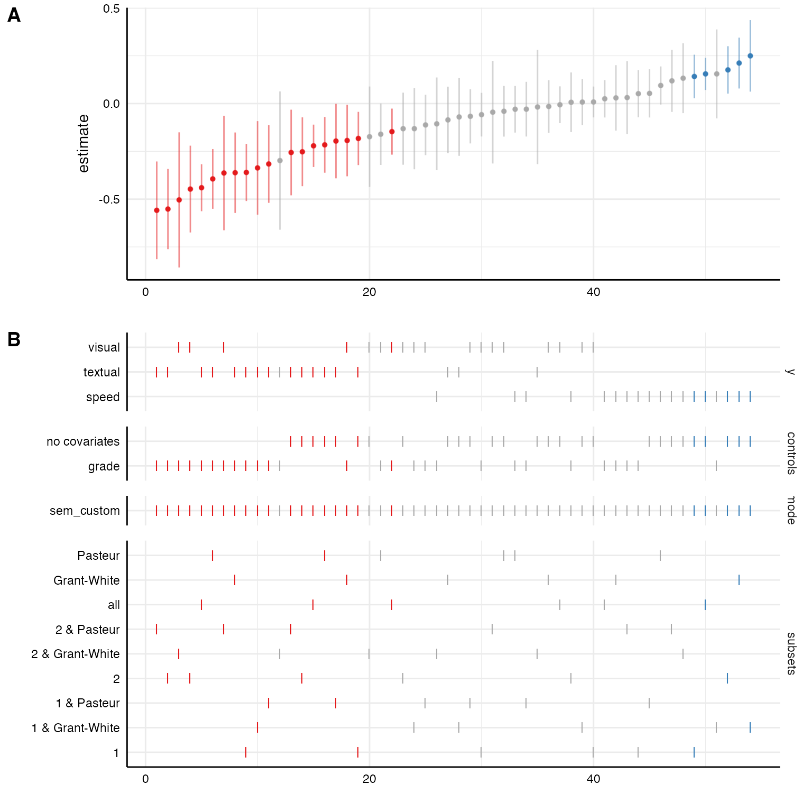
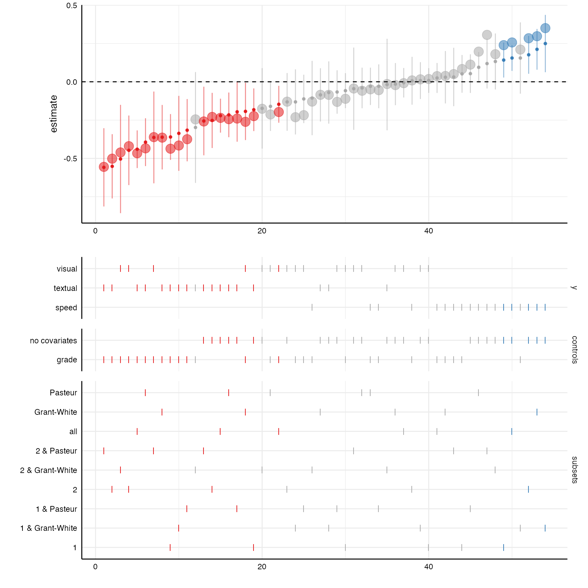
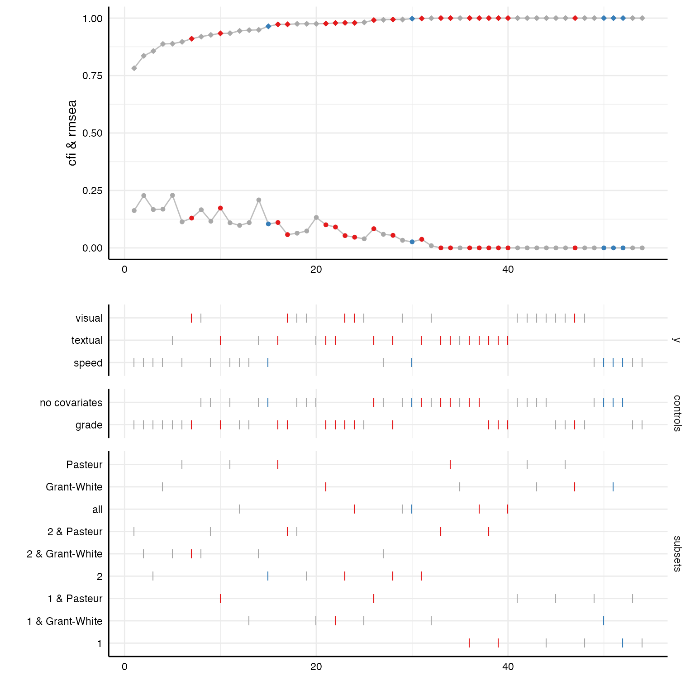

# Incorporating structural equation models

Sometimes, we may want to estimate relationships between latent
variables and we are interested in the effect of different measurement
models on the relationship of interest. Because specifically customized
model-functions can be passed to
[`specr()`](https://masurp.github.io/specr/reference/specr.md) many
different model types (including structural equation models, multilevel
models…) can be estimated. This vignette exemplifies how to integrate
latent measurement models and estimate structural equations models
(SEM).

## Preparations

### Preparing the data set

\
`# Load packages`\
[`library`](https://rdrr.io/r/base/library.html)`(`[`tidyverse`](https://tidyverse.tidyverse.org)`)`\
[`library`](https://rdrr.io/r/base/library.html)`(`[`specr`](https://masurp.github.io/specr/)`)`\
[`library`](https://rdrr.io/r/base/library.html)`(`[`lavaan`](https://lavaan.ugent.be)`)`

For this example, we will use the `HolzingerSwineford1939` data set that
is included in the [lavaan](https://lavaan.ugent.be/) package. We
quickly dummy-code the sex variable as we want to include it as a
covariate.

\
`# Load data and recode`\
`d`` ``<-`` ``HolzingerSwineford1939`` `[`%>%`](https://magrittr.tidyverse.org/reference/pipe.html)` `\
`  `[`mutate`](https://dplyr.tidyverse.org/reference/mutate.html)`(``sex ``=`` `[`as.character`](https://rdrr.io/r/base/character.html)`(``sex``)``,`\
`         school ``=`` `[`as.character`](https://rdrr.io/r/base/character.html)`(``school``)``)`` `[`%>%`](https://magrittr.tidyverse.org/reference/pipe.html)\
`  ``as_tibble`\
\
`# Check data`\
[`head`](https://rdrr.io/r/utils/head.html)`(``d``)`\
`#> ``# A tibble: 6 × 15`\
`#>      id sex   ageyr agemo school grade    x1    x2    x3    x4    x5    x6    x7`\
`#>   ``<int>`` ``<chr>`` ``<int>`` ``<int>`` ``<chr>``  ``<int>`` ``<dbl>`` ``<dbl>`` ``<dbl>`` ``<dbl>`` ``<dbl>`` ``<dbl>`` ``<dbl>`\
`#> ``1``     1 1        13     1 Paste…     7  3.33  7.75 0.375  2.33  5.75 1.29   3.39`\
`#> ``2``     2 2        13     7 Paste…     7  5.33  5.25 2.12   1.67  3    1.29   3.78`\
`#> ``3``     3 2        13     1 Paste…     7  4.5   5.25 1.88   1     1.75 0.429  3.26`\
`#> ``4``     4 1        13     2 Paste…     7  5.33  7.75 3      2.67  4.5  2.43   3   `\
`#> ``5``     5 2        12     2 Paste…     7  4.83  4.75 0.875  2.67  4    2.57   3.70`\
`#> ``6``     6 2        14     1 Paste…     7  5.33  5    2.25   1     3    0.857  4.35`\
`#> ``# ℹ 2 more variables: x8 <dbl>, x9 <dbl>`

Let’s quickly run a simple structural equation model with lavaan. Note
that there are separate regression formulas for the measurement models
and the actual regression models in the string that represents the
model. The regression formulas follows a similar pattern as formulas in
linear models (e.g., using [`lm()`](https://rdrr.io/r/stats/lm.html) or
[`glm()`](https://rdrr.io/r/stats/glm.html)) or multilevel models (e.g.,
using [`lme4::lmer()`](https://rdrr.io/pkg/lme4/man/lmer.html)). This
regression formula will automatically be built by the function
[`setup()`](https://masurp.github.io/specr/reference/setup.md). The
formulas denoting the measurement model (in this case only one),
however, we need to actively paste into the formula string.

### Understanding lavaan syntax and output

\
`# Model syntax`\
`model`` ``<-`` ``"`\
`  # measures`\
`  visual  =~ x1 + x2 + x3`\
\
`  # regressions`\
`  visual ~ ageyr + grade`\
`"`\
\
`fit`` ``<-`` `[`sem`](https://rdrr.io/pkg/lavaan/man/sem.html)`(``model``, ``d``)`\
`broom``::`[`tidy`](https://generics.r-lib.org/reference/tidy.html)`(``fit``)`\
`#> ``# A tibble: 12 × 9`\
`#>    term      op    estimate std.error statistic   p.value std.lv std.all std.nox`\
`#>    ``<chr>``     ``<chr>``    ``<dbl>``     ``<dbl>``     ``<dbl>``     ``<dbl>``  ``<dbl>``   ``<dbl>``   ``<dbl>`\
`#> `` 1`` visual =… =~       1        0          ``NA``    ``NA``   `` ``     0.782   0.670   0.670`\
`#> `` 2`` visual =… =~       0.732    0.130       5.62  1.96``e``- 8``  0.572   0.486   0.486`\
`#> `` 3`` visual =… =~       0.947    0.163       5.82  5.77``e``- 9``  0.740   0.656   0.656`\
`#> `` 4`` visual ~… ~       -``0.147``    0.061``4``     -``2.39``  1.68``e``- 2`` -``0.188``  -``0.197``  -``0.188`\
`#> `` 5`` visual ~… ~        0.539    0.135       4.00  6.36``e``- 5``  0.690   0.345   0.690`\
`#> `` 6`` x1 ~~ x1  ~~       0.751    0.116       6.46  1.06``e``-10``  0.751   0.551   0.551`\
`#> `` 7`` x2 ~~ x2  ~~       1.06     0.104      10.2   0   `` ``     1.06    0.764   0.764`\
`#> `` 8`` x3 ~~ x3  ~~       0.727    0.107       6.80  1.02``e``-11``  0.727   0.570   0.570`\
`#> `` 9`` visual ~… ~~       0.557    0.125       4.44  8.96``e``- 6``  0.912   0.912   0.912`\
`#> ``10`` ageyr ~~… ~~       1.10     0          ``NA``    ``NA``   `` ``     1.10    1       1.10 `\
`#> ``11`` ageyr ~~… ~~       0.268    0          ``NA``    ``NA``   `` ``     0.268   0.511   0.268`\
`#> ``12`` grade ~~… ~~       0.249    0          ``NA``    ``NA``   `` ``     0.249   1       0.249`

Whenever we want to include more complex models in “specr”, it makes
sense to check what output the
[`broom::tidy()`](https://generics.r-lib.org/reference/tidy.html)
function produces. Here, we can see that the variable `term` does not
only include the predictor (as it usually does with models such as “lm”
or “glm”), but it includes the entire paths within the model. If we do
not specify different types of model, this will not be a problem, but if
we do (e.g., “sem” and “lm”), we need to adjust the parameter extract
function.

## Specification curve analysis with latent variables

### Defining the customized sem model function

In a first step, we thus need to create a specific function that defines
the latent measurement models for the latent measures specified as `x`
and `y` in
[`setup()`](https://masurp.github.io/specr/reference/setup.md) and
incorporate them into a formula that follows the lavaan-syntax. The
function needs to have two arguments: a) formula and b) data. The exact
function now depends on the purpose and goals of the particular
question.

In this case, we want to include three different latent measurement
models for dependent variables. First, we have to define a *named list*
with these measurement models. This is important as the function makes
use of the “names”.

In a second step, we need to exclude the “+ 1” placeholder the specr
automatically adds to each formula if no covariates are included (in
contrast to [`lm()`](https://rdrr.io/r/stats/lm.html) or
[`lme4::lmer()`](https://rdrr.io/pkg/lme4/man/lmer.html),
[`lavaan::sem()`](https://rdrr.io/pkg/lavaan/man/sem.html) does not
support such a placeholder). Third, we need to make sure that only those
measurement models are integrated which are actually used in the
regression formula (it does not matter whether these are independent or
control variables). Fourth, we need to paste the remaining measurement
models into the formula. Finally, we run the structural equation model
(here, additional arguments such as `estimator` could be used).

\
`sem_custom`` ``<-`` ``function``(``formula``, ``data``)`` ``{`\
`  `\
`  ``# 1) Define latent variables as a named list`\
`  ``latent`` ``<-`` `[`list`](https://rdrr.io/r/base/list.html)`(``visual ``=``  ``"visual  =~ x1 + x2 + x3"``,`\
`                 textual ``=`` ``"textual =~ x4 + x5 + x6"``,`\
`                 speed ``=``   ``"speed   =~ x7 + x8 + x9"``)`\
`  `\
`  ``# 2) Remove placeholder for no covariates (lavaan does not like "+ 1")`\
`  ``formula`` ``<-`` `[`str_remove_all`](https://stringr.tidyverse.org/reference/str_remove.html)`(``formula``, ``"\\+ 1"``)`\
`  `\
`  ``# 3) Check which of the additional measurement models are actually used in the formula`\
`  ``valid`` ``<-`` ``purrr``::`[`keep`](https://purrr.tidyverse.org/reference/keep.html)`(`[`names`](https://rdrr.io/r/base/names.html)`(``latent``)``, `\
`                       ``~`` ``stringr``::`[`str_detect`](https://stringr.tidyverse.org/reference/str_detect.html)`(``formula``, ``.x``)``)`\
`  `\
`  ``# 4) Include measurement models in the formula using lavaan syntax`\
`  ``formula`` ``<-`` `[`paste`](https://rdrr.io/r/base/paste.html)`(``formula``, ``"\n"``,`\
`                   `[`paste`](https://rdrr.io/r/base/paste.html)`(``latent``[``valid``]``, `\
`                         collapse ``=`` ``" \n "``)``)`\
`  `\
`  ``# 5) Run SEM with sem function`\
`  ``lavaan``::`[`sem`](https://rdrr.io/pkg/lavaan/man/sem.html)`(``formula``, ``data``)`\
`}`\
\
`# In short:`\
`sem_custom`` ``<-`` ``function``(``formula``, ``data``)`` ``{`\
`  ``latent`` ``<-`` `[`list`](https://rdrr.io/r/base/list.html)`(``visual ``=``  ``"visual  =~ x1 + x2 + x3"``,`\
`                 textual ``=`` ``"textual =~ x4 + x5 + x6"``,`\
`                 speed ``=``   ``"speed   =~ x7 + x8 + x9"``)`\
`  ``formula`` ``<-`` ``stringr``::`[`str_remove_all`](https://stringr.tidyverse.org/reference/str_remove.html)`(``formula``, ``"\\+ 1"``)`\
`  ``valid`` ``<-`` ``purrr``::`[`keep`](https://purrr.tidyverse.org/reference/keep.html)`(`[`names`](https://rdrr.io/r/base/names.html)`(``latent``)``, ``~`` ``stringr``::`[`str_detect`](https://stringr.tidyverse.org/reference/str_detect.html)`(``formula``, ``.x``)``)`\
`  ``formula`` ``<-`` `[`paste`](https://rdrr.io/r/base/paste.html)`(``formula``, ``"\n"``, `[`paste`](https://rdrr.io/r/base/paste.html)`(``latent``[``valid``]``, collapse ``=`` ``" \n "``)``)`\
`  ``lavaan``::`[`sem`](https://rdrr.io/pkg/lavaan/man/sem.html)`(``formula``, ``data``)`\
`}`

### Run the specification curve analysis with additional parameters

Now we use
[`setup()`](https://masurp.github.io/specr/reference/setup.md) like we
are used to. We only include the new function as model parameter and use
the latent variables (see named list in the custom function) as
dependent variables. Warning messages may appear if models do not
converge or have other issues.

\
`# Setup specs`\
`specs`` ``<-`` `[`setup`](https://masurp.github.io/specr/reference/setup.md)`(``data ``=`` ``d``,`\
`               y ``=`` `[`c`](https://rdrr.io/r/base/c.html)`(``"textual"``, ``"visual"``, ``"speed"``)``,`\
`               x ``=`` `[`c`](https://rdrr.io/r/base/c.html)`(``"ageyr"``)``,`\
`               model ``=`` `[`c`](https://rdrr.io/r/base/c.html)`(``"sem_custom"``)``,`\
`               controls ``=`` `[`c`](https://rdrr.io/r/base/c.html)`(``"grade"``)``,`\
`               subsets ``=`` `[`list`](https://rdrr.io/r/base/list.html)`(``sex ``=`` `[`unique`](https://rdrr.io/r/base/unique.html)`(``d``$``sex``)``,`\
`                              school ``=`` `[`unique`](https://rdrr.io/r/base/unique.html)`(``d``$``school``)``)``)`\
\
`# Summarize specifications`\
[`summary`](https://rdrr.io/r/base/summary.html)`(``specs``, rows ``=`` ``10``)`\
`#> Setup for the Specification Curve Analysis`\
`#> -------------------------------------------`\
`#> Class:                      specr.setup -- version: 1.1.0 `\
`#> Number of specifications:   54 `\
`#> `\
`#> Specifications:`\
`#> `\
`#>   Independent variable:     ageyr `\
`#>   Dependent variable:       textual, visual, speed `\
`#>   Models:                   sem_custom `\
`#>   Covariates:               no covariates, grade `\
`#>   Subsets analyses:         1 & Pasteur, 2 & Pasteur, Pasteur, 1 & Grant-White, 2 & Grant-White, Grant-White, 1, 2, all `\
`#> `\
`#> Function used to extract parameters:`\
`#> `\
`#>   function (x) `\
`#> broom::tidy(x, conf.int = TRUE)`\
`#> <environment: namespace:specr>`\
`#> `\
`#> `\
`#> Head of specifications table (first 10 rows):`\
`#> `\
`#> ``# A tibble: 10 × 8`\
`#>    x     y       model      controls      subsets         sex   school   formula`\
`#>    ``<chr>`` ``<chr>``   ``<chr>``      ``<chr>``         ``<chr>``           ``<fct>`` ``<fct>``    ``<glue>`` `\
`#> `` 1`` ageyr textual sem_custom no covariates 1 & Pasteur     1     Pasteur  textua…`\
`#> `` 2`` ageyr textual sem_custom no covariates 2 & Pasteur     2     Pasteur  textua…`\
`#> `` 3`` ageyr textual sem_custom no covariates Pasteur         ``NA``    Pasteur  textua…`\
`#> `` 4`` ageyr textual sem_custom no covariates 1 & Grant-White 1     Grant-W… textua…`\
`#> `` 5`` ageyr textual sem_custom no covariates 2 & Grant-White 2     Grant-W… textua…`\
`#> `` 6`` ageyr textual sem_custom no covariates Grant-White     ``NA``    Grant-W… textua…`\
`#> `` 7`` ageyr textual sem_custom no covariates 1               1     ``NA``       textua…`\
`#> `` 8`` ageyr textual sem_custom no covariates 2               2     ``NA``       textua…`\
`#> `` 9`` ageyr textual sem_custom no covariates all             ``NA``    ``NA``       textua…`\
`#> ``10`` ageyr textual sem_custom grade         1 & Pasteur     1     Pasteur  textua…`

Within the specification table, we don’t really see much difference
compared to standard models such as e.g., “lm”. However, in the formula,
variables refer to latent variables as specified in the custom function.

If we now pass it to
[`specr()`](https://masurp.github.io/specr/reference/specr.md), actual
structural equation models will be fitted in the background.

\
`results`` ``<-`` `[`specr`](https://masurp.github.io/specr/reference/specr.md)`(``specs``)`\
[`plot`](https://rdrr.io/r/graphics/plot.default.html)`(``results``, choices ``=`` `[`c`](https://rdrr.io/r/base/c.html)`(``"y"``, ``"controls"``, ``"model"``, ``"subsets"``)``)`

### Additional insights from “lavaan” objects

Because the
[`broom::tidy()`](https://generics.r-lib.org/reference/tidy.html)
function also extracts standardized coefficients, we can plot them on
top of the unstandardized coefficients with a little bit of extra code.

\
`# Create curve with standardized coefficients`\
`plot_a`` ``<-`` `[`plot`](https://rdrr.io/r/graphics/plot.default.html)`(``results``, ``"curve"``)`` ``+`` `\
`    `[`geom_point`](https://ggplot2.tidyverse.org/reference/geom_point.html)`(`[`aes`](https://ggplot2.tidyverse.org/reference/aes.html)`(``y ``=`` ``std.all``, alpha ``=`` ``.1``, size ``=`` ``1.25``)``)`` ``+`\
`    `[`geom_hline`](https://ggplot2.tidyverse.org/reference/geom_abline.html)`(``yintercept ``=`` ``0``, linetype ``=`` ``"dashed"``)`\
\
`# Choice panel`\
`plot_b`` ``<-`` `[`plot`](https://rdrr.io/r/graphics/plot.default.html)`(``results``, ``"choices"``,`\
`               choices ``=`` `[`c`](https://rdrr.io/r/base/c.html)`(``"y"``, ``"controls"``, ``"subsets"``)``)`\
\
`# Combine plots`\
[`plot_grid`](https://wilkelab.org/cowplot/reference/plot_grid.html)`(``plot_a``, ``plot_b``,`\
`          ncol ``=`` ``1``,           `\
`          align ``=`` ``"v"``,            `\
`          axis ``=`` ``"rbl"``,            `\
`          rel_heights ``=`` `[`c`](https://rdrr.io/r/base/c.html)`(``1.5``, ``2``)``)``  `

Some fit indices are already included in the result data frame by
default. With a few code lines, we can plot the distribution of these
fit indices across all specifications.

\
`# Looking at included fit indices`\
`results`` `[`%>%`](https://magrittr.tidyverse.org/reference/pipe.html)\
`  ``as_tibble`` `[`%>%`](https://magrittr.tidyverse.org/reference/pipe.html)\
`  `[`select`](https://dplyr.tidyverse.org/reference/select.html)`(``x``, ``y``, ``model``, ``controls``, ``subsets``, `\
`         ``fit_cfi``, ``fit_tli``, ``fit_rmsea``)`` `[`%>%`](https://magrittr.tidyverse.org/reference/pipe.html)\
`  ``head`\
`#> ``# A tibble: 6 × 8`\
`#>   x     y       model      controls      subsets       fit_cfi fit_tli fit_rmsea`\
`#>   ``<chr>`` ``<chr>``   ``<chr>``      ``<chr>``         ``<chr>``           ``<dbl>``   ``<dbl>``     ``<dbl>`\
`#> ``1`` ageyr textual sem_custom no covariates 1 & Pasteur     0.991   0.974    0.083``4`\
`#> ``2`` ageyr textual sem_custom no covariates 2 & Pasteur     1       1.02     0     `\
`#> ``3`` ageyr textual sem_custom no covariates Pasteur         1       1.01     0     `\
`#> ``4`` ageyr textual sem_custom no covariates 1 & Grant-Wh…   0.975   0.926    0.132 `\
`#> ``5`` ageyr textual sem_custom no covariates 2 & Grant-Wh…   0.949   0.847    0.209 `\
`#> ``6`` ageyr textual sem_custom no covariates Grant-White     1       1.02     0`\
\
`# Create curve plot`\
`p1`` ``<-`` `[`plot`](https://rdrr.io/r/graphics/plot.default.html)`(``results``, ``"curve"``, var ``=`` ``fit_cfi``, ci ``=`` ``FALSE``)`` ``+`\
`  `[`geom_line`](https://ggplot2.tidyverse.org/reference/geom_path.html)`(`[`aes`](https://ggplot2.tidyverse.org/reference/aes.html)`(``x ``=`` ``specifications``, y ``=`` ``fit_cfi``)``, color ``=`` ``"grey"``)`` ``+`\
`  `[`geom_point`](https://ggplot2.tidyverse.org/reference/geom_point.html)`(``size ``=`` ``2``, shape ``=`` ``18``)`` ``+`` ``# increasing size of points`\
`  `[`geom_line`](https://ggplot2.tidyverse.org/reference/geom_path.html)`(`[`aes`](https://ggplot2.tidyverse.org/reference/aes.html)`(``x ``=`` ``specifications``, y ``=`` ``fit_rmsea``)``, color ``=`` ``"grey"``)`` ``+`\
`  `[`geom_point`](https://ggplot2.tidyverse.org/reference/geom_point.html)`(`[`aes`](https://ggplot2.tidyverse.org/reference/aes.html)`(``x ``=`` ``specifications``, y ``=`` ``fit_rmsea``)``, shape ``=`` ``20``, size ``=`` ``2``)`` ``+`\
`  `[`ylim`](https://ggplot2.tidyverse.org/reference/lims.html)`(``0``, ``1``)`` ``+`\
`  `[`labs`](https://ggplot2.tidyverse.org/reference/labs.html)`(``y ``=`` ``"cfi & rmsea"``)`\
\
`# Create choice panel with chisq arrangement`\
`p2`` ``<-`` `[`plot`](https://rdrr.io/r/graphics/plot.default.html)`(``results``, ``"choices"``, var ``=`` ``fit_cfi``, `\
`           choices ``=`` `[`c`](https://rdrr.io/r/base/c.html)`(``"y"``, ``"controls"``, ``"subsets"``)``)`\
\
`# Bind together`\
[`plot_grid`](https://wilkelab.org/cowplot/reference/plot_grid.html)`(``p1``, ``p2``,`\
`          ncol ``=`` ``1``,           `\
`          align ``=`` ``"v"``,            `\
`          axis ``=`` ``"rbl"``,            `\
`          rel_heights ``=`` `[`c`](https://rdrr.io/r/base/c.html)`(``1.5``, ``2``)``)`

