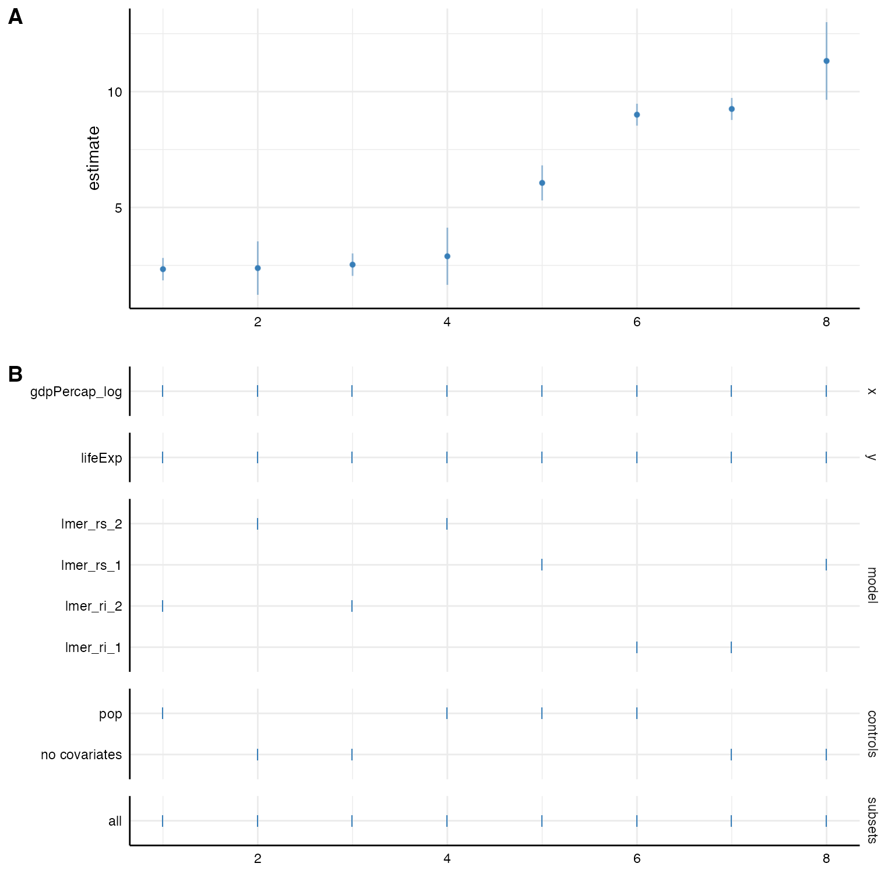

# Incorporating multilevel models

Many data are hierarchical and we want to acknowledge the nested
structure in our models. Specr can easily estimate such multilevel
models. We again have to write a customized function that we can pass
first to [`setup()`](https://masurp.github.io/specr/reference/setup.md)
and the [`specr()`](https://masurp.github.io/specr/reference/specr.md)
will do the rest.

For this example, we will use the `gapminder` data set that is included
in the [gapminder](https://cran.r-project.org/package=gapminder)
package. We quickly recode some variable to get more interpretable
estimates.

\
`# Load packages`\
[`library`](https://rdrr.io/r/base/library.html)`(`[`tidyverse`](https://tidyverse.tidyverse.org)`)`\
[`library`](https://rdrr.io/r/base/library.html)`(`[`specr`](https://masurp.github.io/specr/)`)`\
[`library`](https://rdrr.io/r/base/library.html)`(`[`gapminder`](https://github.com/jennybc/gapminder)`)`\
[`library`](https://rdrr.io/r/base/library.html)`(`[`lme4`](https://github.com/lme4/lme4/)`)`\
[`library`](https://rdrr.io/r/base/library.html)`(`[`broom.mixed`](https://github.com/bbolker/broom.mixed)`)``  ``# tidy() methods for multilevel models`\
\
`# Recode some variables`\
`gapminder`` ``<-`` ``gapminder`` `[`%>%`](https://magrittr.tidyverse.org/reference/pipe.html)\
`  `[`mutate`](https://dplyr.tidyverse.org/reference/mutate.html)`(``gdpPercap_log ``=`` `[`log`](https://rdrr.io/r/base/Log.html)`(``gdpPercap``)``,`\
`         pop ``=`` ``pop``/``1000``)`\
\
`# Check data`\
[`head`](https://rdrr.io/r/utils/head.html)`(``gapminder``)`\
`#> ``# A tibble: 6 × 7`\
`#>   country     continent  year lifeExp    pop gdpPercap gdpPercap_log`\
`#>   ``<fct>``       ``<fct>``     ``<int>``   ``<dbl>``  ``<dbl>``     ``<dbl>``         ``<dbl>`\
`#> ``1`` Afghanistan Asia       ``1``952    28.8  ``8``425.      779.          6.66`\
`#> ``2`` Afghanistan Asia       ``1``957    30.3  ``9``241.      821.          6.71`\
`#> ``3`` Afghanistan Asia       ``1``962    32.0 ``10``267.      853.          6.75`\
`#> ``4`` Afghanistan Asia       ``1``967    34.0 ``11``538.      836.          6.73`\
`#> ``5`` Afghanistan Asia       ``1``972    36.1 ``13``079.      740.          6.61`\
`#> ``6`` Afghanistan Asia       ``1``977    38.4 ``14``880.      786.          6.67`

## Simply adding a random effect structure

For this example, we use the package
[lme4](https://cran.r-project.org/package=lme4) and more specifically
the function [`lmer()`](https://rdrr.io/pkg/lme4/man/lmer.html) to
estimate the multilevel model (more complex models such as poisson or
negative binomial multilevel models can likewise be estimated).

Based on the data set, we want to estimate the relationship between
`gdpPercap` (GDP per capita) and `lifeExp` (life expectancy). Both
variables are nested within both countries and years. We can simply add
a respective random effect structure via the argument `add_to_formula`.
This way, this will be automatically included in the formula of all
specifications. Because `broom` doesn’t provide a `tidy` function for
`merMod`-objects resulting from
[`lme4::lmer()`](https://rdrr.io/pkg/lme4/man/lmer.html), we need to add
a new extraction function like so `fun1 = new_function`. Luckily, we can
use the `broom.mixed` package, which again provides a tidy function for
such objects.

\
`specs`` ``<-`` `[`setup`](https://masurp.github.io/specr/reference/setup.md)`(``data ``=`` ``gapminder``,`\
`                y ``=`` `[`c`](https://rdrr.io/r/base/c.html)`(``"lifeExp"``)``,`\
`                x ``=`` `[`c`](https://rdrr.io/r/base/c.html)`(``"gdpPercap_log"``)``, `\
`                model ``=`` `[`c`](https://rdrr.io/r/base/c.html)`(``"lmer"``)``,`\
`                controls ``=`` ``"pop"``,`\
`                fun1 ``=`` ``function``(``x``)`` ``broom.mixed``::`[`tidy`](https://generics.r-lib.org/reference/tidy.html)`(``x``, conf.int ``=`` ``TRUE``)``,`\
`                add_to_formula ``=`` ``"(1|country) + (1|year)"``)`\
\
`# Check formula`\
[`summary`](https://rdrr.io/r/base/summary.html)`(``specs``)`\
`#> Setup for the Specification Curve Analysis`\
`#> -------------------------------------------`\
`#> Class:                      specr.setup -- version: 1.1.0 `\
`#> Number of specifications:   2 `\
`#> `\
`#> Specifications:`\
`#> `\
`#>   Independent variable:     gdpPercap_log `\
`#>   Dependent variable:       lifeExp `\
`#>   Models:                   lmer `\
`#>   Covariates:               no covariates, pop `\
`#>   Subsets analyses:         all `\
`#> `\
`#> Function used to extract parameters:`\
`#> `\
`#>   function (x) `\
`#> broom.mixed::tidy(x, conf.int = TRUE)`\
`#> `\
`#> `\
`#> Head of specifications table (first 6 rows):`\
`#> `\
`#> ``# A tibble: 2 × 6`\
`#>   x             y       model controls      subsets formula                     `\
`#>   ``<chr>``         ``<chr>``   ``<chr>`` ``<chr>``         ``<chr>``   ``<glue>``                      `\
`#> ``1`` gdpPercap_log lifeExp lmer  no covariates all     lifeExp ~ gdpPercap_log + 1…`\
`#> ``2`` gdpPercap_log lifeExp lmer  pop           all     lifeExp ~ gdpPercap_log + p…`\
\
`# Run analysis and inspect results`\
`results`` ``<-`` `[`specr`](https://masurp.github.io/specr/reference/specr.md)`(``specs``)`\
`` #> Warning: There was 1 warning in `dplyr::mutate()`. ``\
`#> ``ℹ```  In argument: `out = pmap(., fit_spec)`. ``\
`#> Caused by warning:`\
`#> ``!`` Some predictor variables are on very different scales: consider rescaling. `\
`#> You may also use (g)lmerControl(autoscale = TRUE) to improve numerical stability.`\
[`as_tibble`](https://tibble.tidyverse.org/reference/as_tibble.html)`(``results``)`\
`#> ``# A tibble: 2 × 22`\
`#>   x       y     model controls subsets formula model_function effect group term `\
`#>   ``<chr>``   ``<chr>`` ``<chr>`` ``<chr>``    ``<chr>``   ``<glue>``  ``<list>``         ``<chr>``  ``<chr>`` ``<chr>`\
`#> ``1`` gdpPer… life… lmer  no cova… all     lifeEx… ``<fn>``           fixed  ``NA``    gdpP…`\
`#> ``2`` gdpPer… life… lmer  pop      all     lifeEx… ``<fn>``           fixed  ``NA``    gdpP…`\
`#> ``# ℹ 12 more variables: estimate <dbl>, std.error <dbl>, statistic <dbl>,`\
`#> ``#   conf.low <dbl>, conf.high <dbl>, fit_nobs <int>, fit_sigma <dbl>,`\
`#> ``#   fit_logLik <dbl>, fit_AIC <dbl>, fit_BIC <dbl>, fit_REMLcrit <dbl>,`\
`#> ``#   fit_df.residual <int>`

## Defining customized multilevel functions

Sometimes, we may not want to add one random effect structure to all
models and instead explore more specific random structure (and even
several different random effect structures). In this case, we create
several customized lmer-functions that account for different nesting
structures.

\
`# Random intercept model (only country as grouping variable)`\
`lmer_ri_1`` ``<-`` ``function``(``formula``, ``data``,``...``)`` ``{`\
`  ``formula`` ``<-`` `[`paste`](https://rdrr.io/r/base/paste.html)`(``formula``, ``"+ (1|country)"``)`\
`  ``lme4``::`[`lmer`](https://rdrr.io/pkg/lme4/man/lmer.html)`(``formula``, ``data``)`\
`}`\
\
`# Including random slopes (only country as grouping variable)`\
`lmer_rs_1`` ``<-`` ``function``(``formula``, ``data``,``...``)`` ``{`\
`  ``slopevars`` ``<-`` `[`unlist`](https://rdrr.io/r/base/unlist.html)`(`[`strsplit`](https://rdrr.io/r/base/strsplit.html)`(``formula``, ``" ~ "``)``)``[``2``]`\
`  ``formula`` ``<-`` `[`paste0`](https://rdrr.io/r/base/paste.html)`(``formula``, ``"+ (1 + "``, ``slopevars``, ``"|country)"`` ``)`\
`  ``lme4``::`[`lmer`](https://rdrr.io/pkg/lme4/man/lmer.html)`(``formula``, ``data``)`\
`}`\
\
`# Random intercept model (lifeExp is nested in both countries and years)`\
`lmer_ri_2`` ``<-`` ``function``(``formula``, ``data``,``...``)`` ``{`\
`  ``formula`` ``<-`` `[`paste0`](https://rdrr.io/r/base/paste.html)`(``formula``, ``"+ (1|country) + (1|year)"``)`\
`  ``lme4``::`[`lmer`](https://rdrr.io/pkg/lme4/man/lmer.html)`(``formula``, ``data``)`\
`}`\
\
`# Including random slopes (intercept and slopes are nested in both countries and years)`\
`lmer_rs_2`` ``<-`` ``function``(``formula``, ``data``,``...``)`` ``{`\
`  ``slopevars`` ``<-`` `[`unlist`](https://rdrr.io/r/base/unlist.html)`(`[`strsplit`](https://rdrr.io/r/base/strsplit.html)`(``formula``, ``" ~ "``)``)``[``2``]`\
`  ``formula`` ``<-`` `[`paste0`](https://rdrr.io/r/base/paste.html)`(``formula``, ``"+ (1 + "``, ``slopevars``, ``"|country) + ("``, ``slopevars``, ``"|year)"`` ``)`\
`  ``lme4``::`[`lmer`](https://rdrr.io/pkg/lme4/man/lmer.html)`(``formula``, ``data``)`\
`}`

### Setting up specifications

We can now use these function to estimate these models. In this example,
we investigate the influence of different nesting structures on the
fixed effect between GDP per capita and life expectancy.

\
`# Setup specifications with customized functions`\
`specs`` ``<-`` `[`setup`](https://masurp.github.io/specr/reference/setup.md)`(``data ``=`` ``gapminder``,`\
`               y ``=`` `[`c`](https://rdrr.io/r/base/c.html)`(``"lifeExp"``)``,`\
`               x ``=`` `[`c`](https://rdrr.io/r/base/c.html)`(``"gdpPercap_log"``)``, `\
`               model ``=`` `[`c`](https://rdrr.io/r/base/c.html)`(``"lmer_ri_1"``, ``"lmer_ri_2"``, `\
`                         ``"lmer_rs_1"``, ``"lmer_rs_2"``)``,`\
`               controls ``=`` ``"pop"``)`\
\
`# Check specifications`\
[`summary`](https://rdrr.io/r/base/summary.html)`(``specs``)`\
`#> Setup for the Specification Curve Analysis`\
`#> -------------------------------------------`\
`#> Class:                      specr.setup -- version: 1.1.0 `\
`#> Number of specifications:   8 `\
`#> `\
`#> Specifications:`\
`#> `\
`#>   Independent variable:     gdpPercap_log `\
`#>   Dependent variable:       lifeExp `\
`#>   Models:                   lmer_ri_1, lmer_ri_2, lmer_rs_1, lmer_rs_2 `\
`#>   Covariates:               no covariates, pop `\
`#>   Subsets analyses:         all `\
`#> `\
`#> Function used to extract parameters:`\
`#> `\
`#>   function (x) `\
`#> broom::tidy(x, conf.int = TRUE)`\
`#> <environment: namespace:specr>`\
`#> `\
`#> `\
`#> Head of specifications table (first 6 rows):`\
`#> `\
`#> ``# A tibble: 6 × 6`\
`#>   x             y       model     controls      subsets formula                 `\
`#>   ``<chr>``         ``<chr>``   ``<chr>``     ``<chr>``         ``<chr>``   ``<glue>``                  `\
`#> ``1`` gdpPercap_log lifeExp lmer_ri_1 no covariates all     lifeExp ~ gdpPercap_log…`\
`#> ``2`` gdpPercap_log lifeExp lmer_ri_1 pop           all     lifeExp ~ gdpPercap_log…`\
`#> ``3`` gdpPercap_log lifeExp lmer_ri_2 no covariates all     lifeExp ~ gdpPercap_log…`\
`#> ``4`` gdpPercap_log lifeExp lmer_ri_2 pop           all     lifeExp ~ gdpPercap_log…`\
`#> ``5`` gdpPercap_log lifeExp lmer_rs_1 no covariates all     lifeExp ~ gdpPercap_log…`\
`#> ``6`` gdpPercap_log lifeExp lmer_rs_1 pop           all     lifeExp ~ gdpPercap_log…`

### Fit the models

Now, we can simply fit the models with
[`specr()`](https://masurp.github.io/specr/reference/specr.md) as we are
used to.

\
`# Run analysis and plot results`\
`results`` ``<-`` `[`specr`](https://masurp.github.io/specr/reference/specr.md)`(``specs``)`` `\
[`plot`](https://rdrr.io/r/graphics/plot.default.html)`(``results``)`


